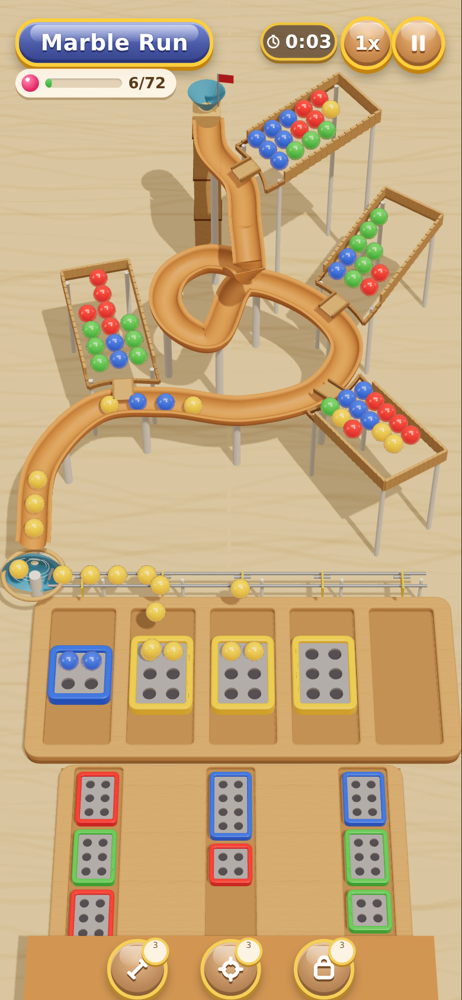
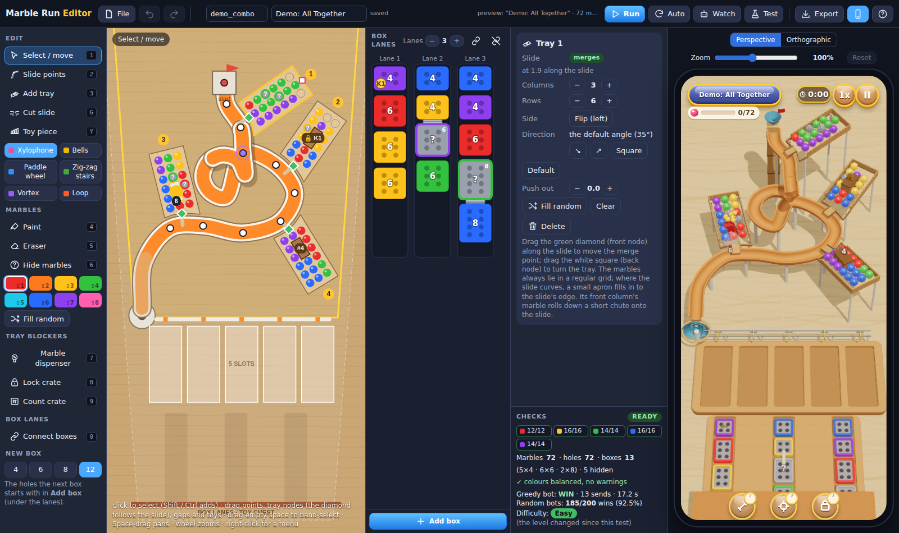

# Marble Run — the sister game of Match Express

Tap a box in a lane: it flies to a free slot under the slide. Marbles of its colour leave the wooden trays, roll
down the orange half-pipe in single file and drop into it. A full box closes and floats away. Fill every box
before all 5 slots are blocked.

The game is built on the Match Express template (`../match-express/`): the same architecture, tools, tests,
level files and builds, retargeted.

| Match Express | Marble Run |
|---|---|
| bus | box (holes in 2 columns: 4 / 6 / 8 / 12 = 2×2, 2×3, 2×4, 2×6) |
| stickman | marble |
| ramp | tray (the same column grid; the front row faces the slide) |
| road | slide (a wooden half-pipe spline) |
| static bays | 5 slots (the slot tray under the slide's end; each fits a 2×6 box) |
| queue lanes | box lanes (2–5) |
| `manScale` | `marbleScale` |

- **`index.html`**: the game. It loads three.js 0.160.0 from a pinned CDN through an import map, with no other
  libraries and no build step. Portrait 9:19.5, scaled to fit, mouse and touch.
- **`editor.html`**: the level editor (see *The editor*). It previews the real game in a phone frame.
- **`shared/sync.js`**: stored settings, the editor's saved levels and level order, and the background bot worker. **`shared/bundle.js`**: packs the game into
  one self-contained HTML file.
- **`shared/core.js`**: the rules, the level format, the layout builder (slide, trays, sorter, pillars), the
  checker, the bots and the difficulty test.
  - It is a plain script with no three.js.
  - The game, the editor, the Web Worker and the Node tests all load this file.
  - It runs on a fixed step (`SIM_DT` = 1/30 s), so the game and every headless run reserve exactly the same marbles
    for the same taps.
- **`tools/`**:
  - the slide and tray geometry (`funnel/geometry.js`);
  - the plan-method content generator (`funnel/content.js`);
  - the demo levels (`make-demos.js`);
  - the presets copy (`sync-presets.js`);
  - the single-file editor (`editor-file.js`);
  - the showcase levels (`make-showcase.js` from `showcase/specs.js`), their pictures (`shoot-showcase-thumbs.js`) and the
    single file (`build-showcase.js`).
- **`levels/`**: one JSON per level: the blocker demos, and `showcase/<category>/<id>.json` with `showcase-order.json`
  and the card pictures (`showcase/thumbs/`).
- **`dist/`**: the single-file builds (`marble-run-showcase.html` so far).
- **`tests/`**: the headless suites (see *Verification*).
- **`vendor/three.module.min.js`**: three.js r160 (MIT), for the offline single-file builds.

## Status

Built in phases, each committed and pushed:

1. **Core**: the rules, the level format, the layout, the checker, the bots, every blocker, gaps and toy pieces, the
   demo levels and the headless tests.
2. **The game page**: the look, the juice and the settings.
3. **The editor**.
4. **The showcase** (this phase): its 38 levels, the menu, My Levels and the editor inside.
5. The 40-level funnel.
6. Every test suite, the screenshots and the dist builds.

## The rules

1. **Sending.** Tapping any box in a lane sends that lane's front box to the leftmost free slot.
   - If no slot is free, the tap is refused: the box shakes, the slot tray flashes red and a toast says "All slots
     are full!". This is not a fail.
   - Boxes never ride the slide. There is no road counter, no lap, no return and no tunnel.
2. **Reservation.**
   - The moment a box lands in its slot, each tray column's front marble checks the boxes in the slots.
   - If a box of its colour has an unreserved hole, the marble is reserved for that box, and the marble behind it
     checks next.
   - The box that reached its slot first is served first. A box is never promised more marbles than it has free
     holes.
   - It all happens in one fixed order: round-robin over the trays down the slide and their columns, one marble per
     column per pass.
   - The marbles reserved at that moment hop and glow. They are exactly the marbles that will drop into that box
     (Match Express's cheering rule).
   - Reservation runs again whenever a column's front changes: a hidden marble reveals, a dispenser drops, a crate
     opens.
3. **The slide.**
   - A reserved front marble rolls down a short chute (0.3 s) from its tray's lip onto the slide at the merge point.
   - It merges only into a free gap. Marbles already on the slide have priority, so trays lower down wait.
   - On the slide every marble rolls at 15 marble diameters a second. No marble overtakes another, and none comes
     closer than 1.15 diameters to the next.
   - A column releases at most one marble each time it rolls forward a row (0.14 s).
4. **The sorter.**
   - The slide drops into a vortex bowl on the left of the slot tray (0.55 s).
   - The bowl feeds a rail along the back of the slot tray, which runs at slide speed, so the order on the rail is
     the order on the slide.
   - Each marble's own flip gate drops it into its box, filling the holes far row first, left then right.
5. **Completion.** A box is complete when its last marble lands. It closes and floats away, and its slot frees in
   that same step.
6. **Win:** every marble is in a box.
7. **Fail ("Out of Space").** All 5 slots hold boxes, nothing is moving or pending, and no tray front can go to any
   slotted box.
   - "Moving or pending" covers a box in the air, a reserved marble, a marble on the slide or the rail, a key in
     flight, a crate lifting, or a hidden marble about to reveal.
   - The fail is called in the first step after the last marble in motion has landed.
   - It also applies when one slot is free but every lane front is a connected group that needs more slots. Nothing
     could ever be sent then either.
8. **Level math.** The marbles of each colour equal the holes of that colour's boxes, dispenser marbles included.
   The checker enforces it.

## The game page



**Open it:**
- `index.html` plays the built-in level;
- `index.html?level=demo_combo` plays a bundled level;
- `?bot` lets the greedy bot play;
- `?debug` shows the core's state.

**How it draws.**
- The page draws the core's state and nothing else.
- The core steps on its fixed `SIM_DT`. The speed setting only feeds it faster, so at any speed the game reserves
  exactly what a headless run does for the same taps; a browser test checks this at 2.25x.
- Between two steps everything is placed from the core's own timing:
  - a marble on the slide sits at `phase + V·t`;
  - in the bowl it is so far round its turn;
  - on the rail it is so far along;
  - a box in the air is so far along its arc.

**The look** (after the target image, with the prototype's proportions):
- **Table:** light wood (or another theme).
- **Slide:** a warm orange-wood half-pipe swept along the core's slide, on slim white pillars (or stacked toy blocks).
- **Start:** a wooden start tower with a blue funnel cup and a little flag.
- **Trays:** wooden trays on stilts. Their floors rise toward the back, and a short chute runs from each lip onto the
  slide.
- **The sorter:**
  - a blue vortex bowl with spinning grooves;
  - the rail along the back of the slot tray;
  - a yellow flip gate over each slot, which flips as a marble drops.
- **The slot tray:** 5 recessed slots.
- **The lanes:** they slide out from a wooden toy chest, whose lid carries the three round booster placeholders.
- **Marbles:** glossy, with clearcoat and environment reflections, drawn as one instanced mesh.
- **Boxes:** a coloured rim and a grey perforated plate; marbles sit half sunk in the holes.
- **Gaps:** yellow-striped deck ends, and red kickers for take-off and landing.
- **Toy pieces:**
  - xylophone bars that light and play a note per marble;
  - an arch of bells that swing and ring;
  - a paddle wheel turned by the marbles;
  - a loop-the-loop and a zig-zag staircase on rails;
  - a vortex bowl.

**Blockers as drawn:**
- a grey "?" on a hidden box or marble;
- cream bellows between connected boxes;
- a gumball dispenser (a red base, a glass globe with its waiting marbles, a count);
- a wooden crate with a padlock (lock), or with a number (count);
- a key on the key box, which flies to its lock.

**Juice:**
- **A box to its slot:** it lifts, arcs, grows from its queue size, and lands with a squash and a dust puff.
- **Reservation:** reserved marbles hop and glow, and keep a soft glow while they wait.
- **Reveals:** a pop and a sparkle.
- **Marbles:** they spin as they roll; a click and a little punch on the box for each one that lands.
- **A completed box:**
  - its lid snaps shut and a ribbon bow ties on;
  - a balloon in its colour pops up;
  - it floats off past the left or right edge of the screen (the nearer one; a connected group goes together);
  - confetti.
- **Slots full:** the box shakes, the slot tray flashes red, and a toast says "All slots are full!".
- **Fail:**
  - the slot boxes wobble like dominoes, then the fail panel;
  - its text says why: all 5 slots full, or the connected boxes at the lane fronts need more free slots than there
    are.
- **Sounds:** synthesised with WebAudio, starting only after the first tap: a soft roll under the marbles on the
  slide, clicks, pops, chimes, notes and bells.

**Settings** (remembered):
- theme: Maple, Walnut, Playmat, Picnic;
- supports: Pillars or Toy blocks;
- box motion: Rigid, or Jelly (boxes squash and wobble as they land and while they fill);
- camera: Perspective or Orthographic, with zoom;
- speed: 1x–3x in 0.25 steps;
- sound.

**In play:**
- a pause menu (Resume, Restart, Settings); the P key toggles it;
- a level timer counting game time;
- the progress bar (marbles in boxes);
- three round booster placeholders, which wobble and do nothing yet;
- a level pack (`window.MR_SHARE.levels`) adds previous / next, "Level x / n" and a stats panel (completion time,
  fail count and the second of each fail, per level; CSV export and reset).

Screenshots (390 × 844, `node tools/shoot-game.js`):
- [the start](screenshots/game-start-390.png);
- [in play](screenshots/game-play-390.png);
- [every blocker](screenshots/game-blockers-390.png);
- [a completed box leaving](screenshots/game-complete-390.png);
- [all slots full](screenshots/game-full-390.png);
- [the fail panel](screenshots/game-fail-390.png).

## The editor

`editor.html` is Match Express's editor, retargeted. Everything it has carries over: the file menu, undo and redo, unique
level ids, drafts, the unsaved dot, the levels list and the level order, exports, the right-click menu, copy / cut /
paste / duplicate / delete / nudge on whatever is selected, band selection, keyboard shortcuts for every tool and the
`?` help sheet.



- **The view** is the table from above: the slide (overpasses drawn over the stretch below them), the trays with their
  marbles, the start tower, the sorter's bowl and rail, the 5 slots, the box lanes and the toy chest. The game's slide
  zone is the yellow frame; whatever leaves it turns red.
- **The slide** (tool `P`, or `2`): click it to add a point (pulled into the zone if it lands outside), drag points,
  right-click or long-press to delete. The first point is the start tower; after the last one the slide runs on along
  its fixed tail into the sorter. A point's inspector turns its stretch into a spiral (left or right, its radius) and
  pins its height. Trays, gaps and toy pieces stay where they are on the table when the slide changes.
- **Trays** (`R`, or `3`): click beside the slide; the tool finds the nearest spot free of warnings. The front node
  (the green diamond) always snaps to the slide's edge and sets the merge point; drag it along the slide. The back node
  turns the tray. The inspector sets columns, rows, side, tilt (or square to the slide, or the default 35°), push and
  fills it at random.
- **Marbles**: paint (`B`), erase (`E`) and the hidden brush (`H`) in 8 colours (`Shift 1-8`).
- **Blockers**: drag across tray cells with the marble dispenser (`D`), the lock crate (`K`, with a key-box picker) or
  the count crate (`N`). One blocker per column; a dispenser needs a cell in front of it.
- **Gaps**: the cut tool (`G`) cuts the slide where it is clicked; drag a gap along the slide; the inspector sets its
  length and its ends (flat, or take-off and landing ramps).
- **Toy pieces** (new, `Y`): pick xylophone, bells, paddle wheel, zig-zag stairs, vortex or loop and click the slide;
  drag them along it; the inspector changes the piece and its length. They are decorative: the checker keeps them off
  spirals, overpasses, gaps and merge points.
- **Box lanes**: 2–5 lanes; *Add box* picks lane, colour, holes (4/6/8/12) and hidden; drag boxes within and between
  lanes; double-click toggles hidden; Shift-click 2-3 touching boxes (also across neighbouring lanes) and press `L` to
  connect them.
- **The level card**: id, name, role, target difficulty, lane count, `marbleScale` (− / + / Auto: the largest the level
  has room for).
- **Checks**: marbles against holes per colour, every checker warning (click one to see it), and **Test**: the greedy
  bot and 200 random bots in a background Web Worker running the same core, with the difficulty label.
- **The preview** is the real game page in an iframe, fed by `postMessage`: *Run* restarts it, *Auto* restarts it
  500 ms after each edit, *Watch* lets the greedy bot play, and its camera switch and zoom are the game's own settings.
- **Exports** are frozen copies: the level JSON (with its id), a playable single-file HTML of the level or of the whole
  level order (three.js inside, no network), the order JSON. The game page never reads the editor's storage.

## The showcase

`dist/marble-run-showcase.html` is one file to try everything (double-click, no server, no network), like Match
Express's. It opens on a start menu of level cards in categories:

- **Basics**: the same idea at four difficulties, Easy to Very Hard.
- **Blockers**: hidden box, connected pairs, connected triples, marble dispenser, hidden marbles, lock & key crate,
  count crate, all combined.
- **Layouts**: *Slides* (spiral, S-curve, hairpin, zig-zag, winding), *Tray shapes* (tilted, square to the slide,
  steep, deep and narrow, wide and shallow) and *Lane counts* (2-5).
- **Jumps**: a first gap, take-off ramps, two gaps, a long jump, a spiral and a gap.
- **Toy pieces**: one level per piece (xylophone, bells, paddle wheel, zig-zag stairs, vortex, loop-the-loop) and a
  parade of three.
- **Funnel**: the 40 levels as numbered tiles, played in order (the won ones ticked, the next one to play
  highlighted).
- **My Levels**: levels saved from the editor inside the showcase (below).

Each card has the level's picture, its name and tags: difficulty (the random bot's win rate), lanes, blockers, gaps,
toy pieces. In play: home, previous / next inside the category, the timer, pause (`P`) with Resume, Restart,
Settings and Back to menu, the three booster placeholders, and the stats panel (completion time, fails and the second
of each fail per level, CSV export, reset). Settings (theme, supports, box motion, camera and zoom, speed 1x-3x in
quarters, sound) open from the menu and in play and are remembered.

The menu's pencil opens the level editor over the showcase with any level. Saving never changes that level: the
showcase keeps a copy under the next free suffix of its id (`slide-hairpin_1`, `_2`, ...) in My Levels, where each
card can be played, edited again, exported as JSON or deleted, and *Export all* saves them together.

The levels are made by `tools/make-showcase.js` from `tools/showcase/specs.js` (slides as point lists or turtle
programs, tray requests, gaps and toy pieces on clean stretches, content from the plan method tuned to a target
label) into `levels/showcase/<category>/<id>.json`; `tools/shoot-showcase-thumbs.js` takes the card pictures and
`tools/build-showcase.js` packs the single file.


The labels are measured, not chosen (`meta.difficulty`, from 100 random-bot games; `meta.random` holds the rate):

| Category | Levels (label, random-bot win rate) |
|---|---|
| Basics | Easy 100%, Medium 25%, Hard 9%, Very Hard 0% |
| Blockers | hidden box Easy 59%, pairs Medium 42%, triples Medium 40%, dispenser Easy 54%, hidden marbles Easy 75%, lock & key Easy 66%, count crate Easy 95%, all combined Easy 86% |
| Layouts | every slide, tray shape and lane count Medium (18-42%) |
| Jumps | first jump Easy 100%, ramps Medium 35%, two gaps Medium 37%, long jump Easy 55%, spiral and gap Easy 52% |
| Toy pieces | each piece Medium (32-44%), the parade Easy 61% |

The blocker levels keep the demo levels' content (the point is to see the blocker, not to fight it), so most of them
are Easy. Two levels the search aimed at Medium came out Easy, at the closest it found: the long jump and the spiral
with a gap (55% and 52%), and the toy parade (61%).

## Blockers (all of Match Express's, with the same data and checker spirit)

- **Hidden box** (`hidden` on a lane box):
  - It is grey with a "?"; its size shows.
  - It reveals when it becomes its lane's front box.
  - A connected member sent from behind reveals as it lands in its slot.
- **Connected boxes** (the same `link` on 2–3 touching boxes: one after another in a lane, or neighbouring lanes at
  most one row apart):
  - A group can go only when, in every lane it uses, its topmost member is the front box.
  - Tapping any member sends the whole group. It needs as many free slots as it has members, and the members take
    the leftmost free slots.
  - Each member fills with its own colour. A full member keeps its slot until all members are full; then they leave
    together.
  - The checker reports `link-single`, `link-size`, `link-shape` and `link-deadlock`.
- **Hidden marbles** (`"?red"` cells): grey with a "?" until the marble has rolled into the front row. It is not
  reserved until then.
- **Marble dispenser** (a tray's `dispensers: [{col, row, w, h, color, count}]`; it replaces the colourful tunnel):
  - It sits over empty cells.
  - Whenever the cell directly in front of it empties, it drops one marble of its colour there, in every column it
    spans.
  - The marbles behind it wait. At 0 it pops away.
  - The checker reports `disp-front`, `disp-count` and `disp-cells`.
- **Lock & key crate** (a tray's `crates: [{col, row, w, h, lock}]` and one lane box with the same `key`):
  - The crate's marbles cannot leave, and they block the marbles behind them.
  - When the key box is complete, its key flies to the lock (0.9 s) and the crate lifts away.
  - The checker requires exactly one key per lock (`lock-keys`, `lock-no-key`, `key-no-lock`).
  - It also requires that the key box's colour is reachable without opening its own crate (`lock-deadlock`).
- **Count crate** (`crates: [{..., count}]`): it shows how many more boxes must be completed and opens at 0
  (`count-range`).

## Level format

One JSON per level:

```
{format:1, type:'marble-run-level', id, name,
 slide:{points:[{x, z, y?, spiral?:{r, side}}], gaps:[{at, len, ramp:'flat'|'updown'}], toys:[{kind, at, len?}]},
 trays:[{side, rows, columns:[[colours front→back]], at|cp, tilt?, shape?, push?, crates?:[], dispensers?:[]}],
 lanes:[[{color, size, hidden?, link?, key?}]], laneCount?, marbleScale?, meta?}
```

- **Slide points** run from the start tower (top) down. The engine adds the fixed tail into the sorter's bowl.
- **Heights** are worked out by the core: the slide always descends, at 0.05 per unit. Wherever it passes over itself
  (a spiral's loop), it drops enough before the crossing for the upper deck to clear the lower one by 0.8. A point's
  `y` pins a height.
- **Trays.**
  - `at` is the merge point's arc length along the slide (or `cp`, a control point).
  - `side` is +1 / −1: right / left of the way the marbles travel.
  - By default a tray points 35° outward and up the screen. `tilt` sets another screen angle, `shape` points it at a
    node, and `push` stands it further from the slide.
  - Every tray is a regular grid (a `spread` is dropped, as in Match Express). Its floor rises 10° toward the back.
- **Toy pieces** (`slide.toys`) are decoration: xylophone bridge, bells, paddle wheel, zig-zag staircase, vortex
  bowl, loop-the-loop.
  - They never change a marble's progress, speed, spacing or order; a test plays the same game with and without them.
  - The loop and the vortex bend a marble's path as a prolate cycloid whose radius is at least `len/π`. It never
    moves slower than on the plain slide, and two marbles 1.15 diameters apart stay at least a marble apart.
  - The checker keeps toys off the spirals and their overpasses, and away from merge points, gaps, the ends and each
    other.
- **Gaps** are ported from Match Express. Marbles fly an arc over them at the same progress speed. The checker keeps
  gaps off the spirals and away from the ends, other gaps and merge points.

## The screen and the camera

- **Screen:** a fixed portrait screen (900 × 1950 design pixels, 9:19.5) and one camera for every level:
  perspective, 30° field of view, looking down 53°.
- **The slot tray fills the width**, as in the prototype. That sets the camera, and at 53° the 5 slots take a little
  more height than asked (about 15%).
- **Rows:**

  | zone | rows |
  |---|---|
  | slide zone | 6.5–55.5% |
  | sorter bowl, rail and slot tray | 55.5–76% |
  | lanes and toy chest | 76–100% |

- **Queue boxes** are drawn at 0.64 of their size and grow to full size as they fly to their slot. About 2.5 boxes
  of each lane show in front of the toy chest they slide out from.
- **The orthographic camera** looks the same way. It keeps the slide zone's top edge and the slot tray's back edge on
  the same rows, so both cameras share almost the same slide zone. In orthographic view the slot tray is a little
  narrower than the screen.

## Bots

- **Greedy:** it sends the box that would get the most marbles right away, and a box it would fill outright first.
  - It works this out on a what-if over **deep copies** of the trays' columns, the marbles and the boxes, with the
    new box landing last.
  - Nothing in the real game changes, not even a hidden colour. A test snapshots the state around it. The prototype
    leaked reveals here.
  - With nothing to gain it waits while marbles are still moving; otherwise it digs for the box whose colour sits
    nearest the tray fronts.
- **Random:** it sends any legal box every 0.4 s of game time.
- **Adversary** (for the fail-free proofs of levels 1–5): it always sends the box that gets the fewest marbles.

Built-in and demo levels (100 random games each, seeds 1000+; the greedy bot wins all):

| level | greedy | random wins |
|---|---|---|
| Marble Run (built-in) | 17.2 s | 89/100 (Easy) |
| Demo: Hidden Boxes | 20.7 s | 51/100 (Easy) |
| Demo: Connected Boxes | 19.6 s | 23/100 (Medium) |
| Demo: Marble Dispensers | 16.4 s | 50/100 (Easy) |
| Demo: Hidden Marbles | 17.6 s | 80/100 (Easy) |
| Demo: Lock & Key | 18.0 s | 51/100 (Easy) |
| Demo: Count Crate | 18.7 s | 84/100 (Easy) |
| Demo: All Together | 16.5 s | 82/100 (Easy) |

**Pace.** Marbles flow much faster than Match Express's buses ride their laps: 72 marbles take the greedy bot about
17 s. The funnel's "at least 35 minutes at 2x" will need bigger levels later in the funnel; that is measured and
reported in the funnel phase.

## Verification

```
node tests/rules.test.js      # 25 checks: sending, refusals, reservations (order, first-landed first, holes),
                              # the cheering set = the marbles that land (every lap of every game), the slide (no
                              # overtaking, spacing, merges only into gaps), hole order, completion, win, rule 9's
                              # fail and its timing, pending events, the bots' deep-copied lookahead
node tests/blockers.test.js   # 30 checks: every blocker, the checker rules for them, the demo levels
node tests/shared.test.js     # 15 checks: the level format, the checker, labels, testLevel, determinism
node tests/gaps.test.js       # 8 checks: gaps (flight, pillars, warnings), toy pieces (spacing in space through each,
                              # the same game with and without them, warnings)
node tests/layout.test.js     # 11 checks: the screen zones, the slot tray across the width, 2.5 boxes per lane, 2-5 lanes
node tests/camera.test.js     # 5 checks: perspective and orthographic, the shared slide zone
node tests/lanes.test.js      # 11 checks: 2-5 lanes, sending from each, connected boxes across lanes
node tests/trays.test.js      # 8 checks: regular grids, the lean, apron and chute, tilt and push, marbleScale, overlaps
node tests/browser.test.js    # 22 checks (Playwright): a real tap, the glow, the drawn spacing on the slide, the game
                              # at 2.25x = a headless run for the same taps, refusals, hidden "?", every box leaving
                              # off the side of the screen, win, the dominoes fail, pause, settings, speed, timer, boosters
node tests/editor.test.js     # 139 checks (Playwright): the shell and its preview, shortcuts, selection and the clipboard
                              # for every kind of thing, the slide, trays, blockers, gaps, toy pieces, box lanes, the
                              # level card, drafts and ids, the level order, exports opened from file:// and won level
                              # by level, the bot worker (the same numbers as the core headless), Watch, camera and zoom
```

All 274 checks pass.
