# Match Express — playable prototype + level editor

- **`index.html`** — the game. three.js 0.160.0 from a pinned CDN through an import map;
  no other libraries, no build step. Portrait 9:19.5, scales to fit, mouse and touch.
- **`editor.html`** — the level editor, with its own copy of the game running beside it.
- **`shared/core.js`** — the rules, the level format, validation, the layout builder
  (road, ramps, tunnels, pillars), the bots and the difficulty test. Plain script, no
  three.js; the game, the editor, the Web Worker and the Node tests all load this file.
- **`shared/sync.js`** — the editor's storage (saved levels by id, the level order,
  prefs) and the background bot worker. The game never reads the editor's storage.
- **`shared/bundle.js`** — packs the game into one self-contained HTML file (core,
  sync and three.js inlined). The editor's *Export playable HTML* and
  `tools/build-standalone.js` both use it.
- **`vendor/three.module.min.js`** — three.js r160 (MIT), the same version as the
  CDN pin, for the single-file exports that must run offline.

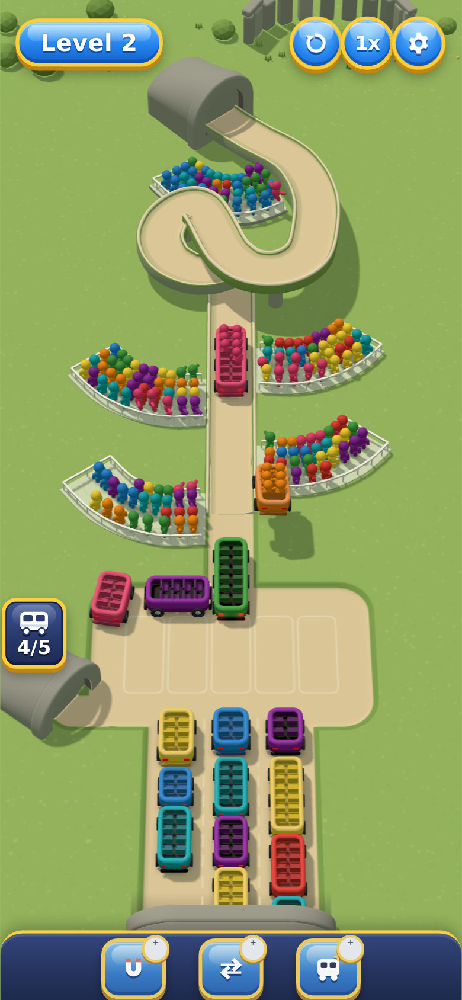

**Showcase:** `dist/match-express-showcase.html` is one file with every feature to try (see *High-up
update* and *Showcase update*). **Editor:** `dist/match-express-editor.html`. Screenshots at 390 × 844
(`node tools/shoot-showcase.js`):
- [the menu](screenshots/showcase-menu-390.png) and [the settings panel](screenshots/showcase-settings-390.png);
- one level per theme, each on its plateau: [meadow](screenshots/theme-meadow-390.png),
  [desert](screenshots/theme-desert-390.png), [blossom](screenshots/theme-blossom-390.png),
  [town](screenshots/theme-town-390.png);
- a spiral level in [Perspective](screenshots/spiral-persp-390.png) and in
  [Orthographic](screenshots/spiral-ortho-390.png);
- [a 12-seat bus in Jelly mode bending in a spiral](screenshots/jelly-spiral-390.png);
- a bus [driving into the dark exit tunnel](screenshots/tunnel-exit-390.png) and [coming out of the return tunnel](screenshots/tunnel-return-390.png) (close-ups);
- [a ramp on a tight curve: a regular grid of stickmen, a small curved apron to the road edge](screenshots/ramp-curve-390.png) (close-up);
- [a full bus under its parachute, out past the board's edge](screenshots/parachute-edge-390.png);
- [a 5-lane level with the booster bar](screenshots/five-lanes-bar-390.png);
- [stickmen at 1.3x](screenshots/stickmen-1.3-390.png), and [close up](screenshots/stickmen-1.3-close-390.png);
- [connected buses side by side in the queue, the leading one a little ahead](screenshots/connected-queue-390.png) (close-up);
- [a connected group parachuting together](screenshots/connected-parachute-390.png), and [close up](screenshots/connected-parachute-close-390.png);
- the Bridge terrain: [an S-curve](screenshots/bridge-390.png) and [a double spiral](screenshots/bridge-spiral-390.png);
- [a bus in the air over a gap, between its take-off and landing ramps](screenshots/gap-jump-390.png) (close-up), and
  [the whole level](screenshots/gap-jump-wide-390.png);
- [the pause menu](screenshots/pause-menu-390.png);
- [the camera zoomed out to a 45° field of view](screenshots/camera-zoom-45-390.png);
- [the funnel's numbered tiles in the menu](screenshots/showcase-funnel-390.png);
- the editor inside the showcase: [its level picker](screenshots/editor-picker-390.png), [the editor on a phone](screenshots/editor-in-showcase-390.png)
  (laid out 1280 px wide and scaled down to fit), [the editor at 1440 × 900](screenshots/editor-in-showcase.png) after a save
  (`f30_1`), and [My Levels in the menu](screenshots/my-levels-390.png).

## Tests, screenshots and builds

- **Every suite passes** (the commands are under *Verification*):

  | suite | checks | | suite | checks |
  |---|---|---|---|---|
  | rules | 37 | | gaps | 70 |
  | blockers | 44 | | browser | 148 |
  | layout | sweep OK | | funnel | 46 |
  | lanes | 59 | | showcase | 38 |
  | shared | 74 | | editor | 63 |
  | camera | 10 | | standalone | 18 |
  | ramps | 21 | | | |

- **New this round:** `tests/gaps.test.js`; in `tests/browser.test.js` the stickmen size, connected buses
  and parachutes, terrain, jumps, pause / timer / boosters and camera zoom blocks; in `tests/funnel.test.js`
  the blocker intro levels and the blockers after 20; in `tests/showcase.test.js` the funnel category and the
  editor with My Levels; in `tests/blockers.test.js` one win event per game. `tests/ramps.test.js` checks
  every level's stickmen for overlaps.
- **Fixed while testing and taking the screenshots:**
  - Zoomed out (the camera zoom), the view could run past the ground's edge, and the queued buses past the
    queue tunnel showed as dark shapes. The ground below now goes on, plain, past its detailed patch, and a
    queued bus wholly inside the queue tunnel is hidden. Two browser checks cover it (both cameras at the
    widest zoom).
  - The editor inside the showcase on a phone is laid out 1280 px wide and scaled down to fit, instead of
    being cut off.
  - The editor keeps the middle of its map view in the middle when its window changes size (before, the
    road could end up off the view until *Fit view*).
  - My Levels: the card's Edit / Export / Delete buttons wrap to fit the card.
  - The browser test's tool panel check now knows the *Cut road* tool (G).
- **Screenshots** (390 × 844 unless noted, `node tools/shoot-showcase.js`): the list is at the top of this
  file. Since Phase 2 a parachuting bus glides off the screen sideways while still above the board, so the
  parachute shot now shows a bus out past the board's edge rather than below it.
- **Card pictures:** all 32 showcase thumbnails were taken again (`node tools/shoot-showcase-thumbs.js`); 27
  changed (larger stickmen), the 5 *Jumps* ones were already current.
- **Builds:** every single file in `dist/` was rebuilt (`build-standalone`, `export-demo-pack`, `build-funnel`,
  `build-showcase`), and the level packs `dist/all-levels.json` and `dist/funnel-40.json` were written again
  (`export-levels`).

## Camera zoom

- A *Camera zoom* slider under the camera switch, in the showcase's settings panel and the game's settings,
  and *Zoom* above the editor's phone preview, each with *Reset* and the value beside it.
- **Perspective:** the field of view, 25° (zoomed in) to 60° (zoomed out), default **30°**; the camera keeps
  its position and angle. **Orthographic:** the orthographic size over the same range, default **16.5588**.
- Saved with the other settings and applied to every level; only the 3D scene zooms. The details and the
  formula for Unity are in *Camera: Perspective or Orthographic* below.

## The editor inside the showcase, My Levels

- **The editor is inside the showcase.** The pencil at the top left of the showcase menu
  opens a list of every level: the showcase's, the funnel's, and My Levels. Picking one
  opens the full level editor over the whole window, with that level loaded.
  - It is the same single-file editor as `dist/match-express-editor.html`, carried inside
    the showcase as base64. It has every editor feature, including the cut-road tool, the
    stickmen size and the phone preview. It makes the showcase file about 4.8 MB (2.1 MB without it).
  - It is laid out for a desktop window. In a narrower one (a phone) it is laid out 1280 px wide and scaled down
    to the window's width, so every part of it stays on the screen, small.
  - *Showcase* (top left) goes back to the menu. *File → Open a showcase level…*
    (<kbd>Ctrl O</kbd>) brings the list back.
- **The originals never change.** *Save* (<kbd>Ctrl S</kbd>) stores a copy under the next
  free suffix of the level's id: `f30` becomes `f30_1`, then `f30_2`, and so on. Saving
  `f30_1` again also makes the next free copy. The copies live in the showcase's
  `localStorage` (key `match-express:my-levels`).
- **My Levels:** the menu's last category, once something is saved. Each card shows a
  small map of the level's road and ramps and has three buttons:
  - **Edit** opens it in the editor (a save makes the next copy);
  - **Export** downloads `<id>.json`;
  - **Delete** removes it.

  Tapping the card plays the level. *Export all* downloads `my-levels.json`, a level pack
  (`{type:'match-express-levels', levels:[...]}`).
- **Tested** (`tests/showcase.test.js`):
  - the picker lists all 72 levels;
  - the editor opens on the chosen level with the gap tool and the stickmen size;
  - two saves make `f30_1` and `f30_2`, and the original stays byte for byte the same;
  - My Levels appears, each level exports one by one or all together, a level plays with
    its edits, and a level can be deleted.

## The funnel inside the showcase

- **Its own category:** the showcase menu ends with *Funnel: 40 levels in order*.
  - **Tiles:** 40 numbered tiles, each tagged with its role, difficulty, lanes and blockers.
  - **In order:** the first level not won yet is highlighted as the one to play next, and
    won levels turn green with a check. A won level moves on to the next one.
  - **Tutorials, popups and the hint** come from each level's meta, as in the 40-level file:
    tutorials on levels 1 and 3, popups on 7, 13, 26 and 32, the hint on 17.
- **Blocker intro levels use their blocker a lot but stay easy:**

  | level | blocker | before | now |
  |---|---|---|---|
  | 7 | hidden buses | 1 | 5 (the first right where the popup points) |
  | 13 | connected pairs | 2 | 4 |
  | 17 | connected triples | 1 | 3 |
  | 26 | colourful tunnels | 1 | 3 (short ones) |
  | 32 | lock boxes | 1 | 2 (each with its own key bus) |

- **More blockers after level 20:** every level from 21 to 40 carries more of them. Hidden
  buses go to 2–3, more connected pairs, 2 tunnels in place of 1, and 2 lock boxes. The
  Relax levels 22, 31 and 36 get a light touch (a hidden bus or two). The finale has
  3 hidden buses, pairs and triples, 2 tunnels and 2 lock boxes.
- **Generator changes** (`tools/funnel/content.js`):
  - `blockers.linkN` asks for exactly that many connected groups.
  - `blockers.lock` is now a count: each box goes on a ramp of its own with its own key
    bus (K1, K2, ...).
  - The popup level's extra hidden buses may sit anywhere early in a lane.
- **Retune, same targets and rules.** Each changed level was searched again with
  `node tools/make-funnel.js --search ...`, keeping its road and ramps.
  - The rules are as before: the greedy bot must win, and a loss can only come from timing
    and order.
  - Levels 1–5 are fail-free, proven by 1000 random games and an adversarial bot.
  - Challenge, Milestone, Finale and Practice levels must land in their band; the others may
    be easier.
  - Every level was then measured again with 200 random games (`--measure`). The bots and the spreadsheet
    were rebuilt too (`levels/funnel/funnel-bots.json`, `dist/funnel.xlsx`); the full table is under
    *Difficulty, measured* below.
  - Levels 6, 8, 10, 12 and 20 had drifted easier after the ramps were straightened (Phase 0) and the
    stickmen grew (Phase 1), so they were searched again too. Level 20 is back in its band. Levels 6, 8, 10
    and 12 are out of band as they were in the last round (see below).
- **Target against measured** (random-bot win rate over 200 games; the greedy bot wins all 40):

  | | in band | Challenge / Milestone / Finale / Practice in band | greedy total |
  |---|---|---|---|
  | last round | 24 / 40 | 13 / 18 | 72.8 min at 1x |
  | now | 19 / 40 | 14 / 18 | 73.7 min at 1x |

  Fewer levels count as in band because the blocker-heavy intro, Relax and Fun levels now come out
  easier than their band, which those roles allow. Every level that must land in its band does, except
  6, 8, 10 and 12. Two generator rules were added: a 4–5-lane level with connected buses needs at least
  6 groups, 3 of them across lanes; `FUNNEL_FRESH=1` never keeps the saved version.
- **Exports:** `node tools/export-levels.js` writes two level packs
  (`{type:'match-express-levels', version:1, name, categories, levels}`, each level the
  same JSON as its file):
  - `dist/funnel-40.json`: the 40 funnel levels in order;
  - `dist/all-levels.json`: every showcase level by category, and the funnel.
- **Tested:**
  - `tests/funnel.test.js`:
    - the intro levels have at least 4 hidden buses, 4 pairs, 3 triples, 3 tunnels or 2 lock boxes, and
      the random bot still wins 60% or more;
    - every level from 21 on has blockers, twice as many per level as 1–20.
  - `tests/showcase.test.js`:
    - the funnel category's 40 tiles in order, the first one up next;
    - level 1 with its tutorial, and a won level going on to the next one;
    - level 7's popup, and the tiles marking won levels;
    - the stats panel lists the funnel's 40 levels after the showcase's.
- **Fixed: one win per game.** When the last buses to leave a level are a connected group, they all
  jump in the same step, and the core used to send one *win* event per bus. The stats then counted
  that win two or three times (level 40 ends on a triple). The core now sends it once. Results,
  timings and every rule are unchanged. `tests/blockers.test.js` checks all 40 funnel levels; 11 of
  them end on a group.
- **Fixed:** the `SPEEDS` test hook is exported again (since Phase 5 it had been commented out by mistake).

## Pause, level timer, round boosters

- **Pause:** the round button in the top-right corner (or <kbd>P</kbd>) pauses the game and
  opens the pause menu. Paused, the core, every animation and the level timer stand still.
  The menu has:
  - **Resume**;
  - **Restart**;
  - **Settings**: the settings panel in the showcase, the settings popover elsewhere. The
    game stays paused, and closing the settings brings the pause menu back;
  - **Back to menu**, in the showcase only.

  Restart and the settings gear moved from the top bar into this menu. Where older sections
  below say ⚙, that is now *pause → Settings*. Once a level is won or lost it can no longer
  be paused.
- **Level timer:** a pill in the top bar, between the level name and the speed button. It
  shows the level's own clock in m:ss. It stops while the game is paused or held (popups,
  stats), stops at the level's end, and starts again at 0:00 on a restart. It counts game
  time, so at 2x it runs twice as fast, the same clock the stats use for completion times.
- **Round boosters:** the three booster buttons in the bottom bar are round. They are
  still placeholders with no effect.
- **Tested** (`tests/browser.test.js`, *pause, timer, boosters*):
  - Paused, the game time, the buses and the timer stand still; Resume carries on.
  - The menu items are right; <kbd>P</kbd> toggles the pause.
  - Restart sets the timer back to 0:00, and the timer stops at the end of a level.
  - The top bar order is level name, timer, speed, pause, and the booster buttons are round.

  `tests/showcase.test.js` checks *Back to menu* in the showcase's pause menu.

## Gaps and jumps

The road can be cut into pieces. Buses jump the gaps.

- **The format:** `road.gaps: [{at, len, ramp}]`.
  - `at` is the gap's middle, as a distance along the road.
  - `len` is 0.6 to 2.4 long.
  - `ramp` is `'flat'` (plain ends) or `'updown'` (a take-off ramp before the gap and a
    landing ramp after it).
- **Both ends at the same height:** the road is levelled across a gap and eases in and out
  over 0.9 on each side.
- **The rules (core):**
  - **Run-up:** a bus (a connected group as one) speeds up to 1.35x over the last 1.6
    before a gap and while crossing it.
  - **One at a time:** only one bus or group is ever over a gap. The next one waits at the
    near edge until the one ahead has landed and its rear has cleared the far side.
  - **No stopping over a gap.** Nothing overtakes.
  - The counter, sending, boarding and every other rule are unchanged. A level without gaps
    plays exactly as before.
- **The checker:**
  - A gap may not be on a spiral, too near the road's ends, or too near another gap.
  - No boarding point may sit on a gap, or just after it, where a landing bus (or the
    longest connected group) would still be over it when it stops.
  - These show as `gap-spiral`, `gap-ends`, `gap-gap` and `gap-ramp`.
- **Drawn:**
  - **Ravine:** the road stops at striped edges and a ravine drops through the plateau.
    On a Bridge, the deck simply breaks.
  - **Ramps:** with `updown`, low striped wedges rise to the take-off edge and fall away
    from the landing edge.
  - **The jump:** the bus flies one arc. It is higher for a longer gap and off a ramp,
    its nose up on take-off and down on landing. It gives a little hop as it leaves and a
    squash with a puff of dust as it lands.
  - **Jelly buses** follow the same arc.
  - **No pillars** stand under a gap.
- **Editor:** the *Cut road* tool (<kbd>G</kbd>).
  - Click the road to cut a gap there, or drag a gap along the road; the arrow keys
    nudge it.
  - The inspector sets its length (0.2 steps) and its ends (*Flat* or *Take-off + landing
    ramps*); Delete removes it. The right-click menu has the same options, plus *Cut the
    road here*.
  - A road edit keeps each gap where it is on the ground.
- **Showcase:** a *Jumps* category with 5 levels: *First jump*, *Take-off ramps*, *Two
  gaps*, *Long jump* (connected pairs jumping together) and *Spiral and gap*. Their gaps
  were placed by `tools/make-showcase.js` on the clean stretch nearest the spot each spec
  asks for. All five measure *Easy* (random bot 56–100%), even where the content search
  pushed hard.
- **Tested:**
  - `tests/gaps.test.js`, 70 checks:
    - the format;
    - level ends, and no pillar under a gap;
    - the checker's four warnings;
    - a level without gaps keeps the plain speed and no gap limit a whole game long;
    - whole greedy games of every gap level, watched step by step: nothing overtakes,
      only one unit is over a gap, the next waits at the edge, nobody stops over a gap,
      the boost happens only near a gap, and the greedy bot wins.
  - `tests/browser.test.js` *jumps*:
    - in Rigid on the Plateau and Jelly on a Bridge, every bus is in the air over a gap and
      every landing squashes it;
    - looking down into a gap shows the ravine or the ground far below;
    - the editor's cut tool adds, sets, drags, keeps and deletes gaps.

## Terrain: Plateau or Bridge

A setting in the showcase (*Settings → Terrain*), saved with the other settings. In the
game it is a button or `?terrain=bridge`. It is drawn only: every rule, timing and level is
the same in both.

- **Plateau** (as before): the whole board stands on a tall plateau, with the road in a
  groove on top.
- **Bridge:** the plateau stays only under the bottom part: the queue, the queue tunnel,
  the bays and the return tunnel.
  - **The road is a bridge** high up on tall, slim pillars that stand on the ground far below.
    The ground stays in view between them.
  - **The ramps hang beside the road** at road height. Each stands on four slim pillars of
    its own.
  - **The exit tunnel** stands on its own tall stone base.
- **Tested** (`tests/browser.test.js`, *terrain*):
  - In Bridge, the plateau is under the bays, the queue and the return tunnel, but not under
    the road or the ramps.
  - Every road pillar and every ramp pillar stands on the ground far below.
  - Each ramp has its own pillars.
  - The same game plays out identically in Plateau and Bridge: the same times, sends and
    bus positions.
  - The setting is remembered.

## Connected buses polish

Drawn only: the rules, the queue, the bays and the timings are unchanged.

- **A group parachutes together.** When a connected group is complete, every bus starts
  its exit at the same moment, in the leading bus's direction. Each bus keeps its place
  in the group: the group never splits, fans out or crosses itself.
- **No bus vanishes mid-air.** A parachuting bus glides outward and gently down past the
  board's edge. It stays well above the ground far below and never lands or fades. It is
  hidden only once its whole box, parachute included, has left the screen.
- **Jelly bellows.** In Jelly mode each bus bends smoothly. The bellows run from the
  leader's rear to the follower's front, taken on the bent bodies. They stretch and bend
  with the buses and never pop or cut through a body.
- **Queue and bays.** Connected buses never overlap. Side by side (neighbouring lanes at
  the same place in the queue, or neighbouring bays), they are drawn staggered: the
  leading bus a little ahead and the following one a little behind. The bellows then run
  across from the rear half of one to the front half of the other. The offset (up to
  0.5) is cut short so a bus never comes near the bus ahead or behind it in its lane.
- **Tested** (`tests/browser.test.js`, *connected buses and parachutes*): whole games of
  the connected-bus demos are watched frame by frame. The checks:
  - connected buses never overlap in the queue or the bays;
  - side by side, the leading bus always stands ahead;
  - a completed group leaves in one direction, each bus keeping its place;
  - every parachuting bus is hidden only after it has left the screen.

## Stickmen size per level

- **The field:** each level has a stickman size, `manScale`, from 1 to 1.3 (left out at 1).
- **Ramps grow with it:** a level's ramps grow with its stickmen. The grid's spacing, the
  ramp's margins and the deepest allowed apron are all times the size, so larger stickmen
  never overlap. The no-overlap test runs at each level's own size.
- **Chosen from free space:** `MECore.autoManScale(level)` picks the largest step, up to 1.3,
  at which the level's grown ramps raise no warning it does not already have. Levels with
  few or short ramps get larger stickmen; crowded ones keep the normal size.
- **Every level carries its size:** `tools/set-man-scale.js` wrote it into every level
  (the funnel and showcase generators now set it too):

  | size | levels |
  |---|---|
  | ×1.3 | 6 |
  | ×1.2 – 1.25 | 3 |
  | ×1.05 – 1.15 | 17 |
  | ×1 | 50 (Level 2, both Crowded Rush levels, the demos and most of the funnel) |
- **Seats:** seated in a bus, a stickman stays at most ×1.08, so heads still fit between
  two seat rows. A boarding stickman shrinks to that size during his hop into the bus.
- **Editor:** the level card has *Stickmen size* (− / +, 0.05 steps) and *Auto*. A size
  the level has no room for shows as the usual ramp warnings.
- **Tested:**
  - `tests/ramps.test.js` checks four things:
    - each level's size is the one its free space allows;
    - crowded levels keep 1, and several levels get 1.2 or more;
    - a larger size grows the ramp's spacing, width and margins together;
    - seated stickmen fit their seats.
  - `tests/browser.test.js` (*stickmen size*) checks that the game draws them at their
    level's size (×1.3 next to ×1), and that the editor's − / + and *Auto* set it.

## Ramps: regular grids, curved aprons

Gameplay rules are unchanged; the only play-relevant change is noted under *Boarding order*.

- **Rectangles everywhere:** every ramp is a straight rectangular platform holding a regular
  grid of stickmen, columns × rows, evenly spaced 0.36 apart. The grid is never bent,
  squeezed or fanned, however the road bends.
- **Only the outline adapts:** the front edge lies exactly on the road edge and follows its
  curve. A small apron fills the space between that curved edge and the straight first row.
  The back and side edges are straight, with square corners.
- **The first row** stands 0.34 behind the point where the road edge reaches furthest out
  across the ramp, as close to the road as the apron allows. The boarding point (the middle
  of the front edge, on the road edge) is unchanged.
- **Direction:** a ramp points one way from its boarding point: square to the road by
  default, or turned by its back node in the editor (or an old level's `tilt`). Old bent
  (arc, L) and fanned ramps are straightened along the way they left the road, and their
  `spread` is dropped.
- **Apron warning:** a ramp whose apron would be more than one row deep (0.36), because
  the road bends too much under its front for its width, gets a `ramp-apron` warning. In the
  editor it suggests moving the ramp along the road or making it narrower (or turning it
  square to the road, if it is turned).
- **Editor:**
  - a ramp has its front node (diamond) and one back node (square) that turns it;
  - the inspector shows its direction (*square to the road* or *turned N°*) with a
    *Square to road* button, also in the context menu;
  - the *Spread* stepper and the add / remove node buttons are gone;
  - new ramps start square to the road.
- **No overlap:** two stickmen on a ramp never come closer than a stickman's width (0.31):
  - at the start, since the grid is regular;
  - during column shifts: each man still eases forward with a small overshoot, but never
    comes closer to the man in front of him than a stickman's width. A long shift used to
    let the men behind catch up with the ones ahead;
  - a boarding man first steps straight off the grid onto the apron, then runs to his
    seat, and the man stepping up behind him keeps his distance until the runner has
    hopped in.
- **Boarding order:** the columns board from the middle of the front row out (of two
  equally near, the one the bus passes first). This used to follow each column's exact
  distance to the boarding point, which depended on fine details of the old bent rows.
  It now depends only on the column number, so it changed on some ramps. The greedy bot
  still wins every level.
- **Every level fixed:**
  - `tools/fix-ramps.js` gave each shaped ramp a single direction node, then turned each
    ramp that warned toward square to the road (no effect on play). Only where that was not
    enough did it slide the ramp along the road, as little as possible;
  - `tools/place-ramps.js` placed all the ramps of the most crowded boards together, nearest
    their old boarding points. On *crowded-rush* and *crowded-rush-curve*, ramp 2 is now 9 × 10
    (the same 90 stickmen, laid row by row, front to back), since four straight 6 × 15 ramps
    cannot share those boards. It did the same for funnel levels 25, 33, 35, 37 and 38, some of
    whose ramps changed shape the same way;
  - funnel levels 19, 20, 21, 27, 30 and 36 were made again by the generator; 25, 33 and 35 got
    new content on their new layout (`make-funnel.js --search`);
  - the showcase's *Very Hard* basics level was made again with narrower, deeper ramps (6 × 8);
  - the showcase's *Curved arc*, *L-shape* and *Wide fan* are now *On curves*, *Deep* and
    *Around spirals*.
- **Tested** (`tests/ramps.test.js`, every ramp of every level):
  - the grid is regular;
  - the front edge is on the road edge;
  - the apron is at most one row deep, and the first row is as close to the road as it
    allows;
  - the back edge is straight with square corners;
  - the boarding point is unchanged and the order is middle-out;
  - no two stickmen on a ramp come closer than 0.31, at the start or through every column
    shift and run of a whole game (the game's own shift animation, every 1/60 s).

## Polish pass

Gameplay rules are unchanged throughout.

### Bus movement: Rigid or Jelly (replaces Articulated)
A game setting: ⚙ → *Buses: Rigid / Jelly*, the showcase's settings panel, or
`index.html?move=jelly`. A saved *Snake* or *Articulated* choice now opens as Jelly. It
is purely visual: speeds, timings and rules are the same, and the browser test plays the
same taps in both modes and gets the same game.
- **The bus:** always looks like a normal single-body bus, with no sections or bellows.
- **On straight road** it is perfectly straight and rigid.
- **In curves and spirals** its body bends smoothly along the road's curve, like soft
  jelly, as one continuous shape. Seats, passengers, wheels and lights follow the bend.
- **The wobble:** entering and leaving a curve, the body bends and straightens with a small
  soft wobble, then settles.
- **In the queue, the bays and on the parachute** the bus is straight. Leaving the road
  for the parachute, it straightens with the same soft wobble.
- **How:** 9 frames run from the bus's front to its back. Each frame's target is the
  bus's path at the frame's own distance from the bus's centre: the main road in 3D, or
  its route through the yard as drawn.
  - Each frame follows its target on a lightly damped spring (17 rad/s, damping 0.32).
    The spring is never more than 0.12 units or 0.2 rad off its target, so the wobble
    stays small.
  - A vertex shader carries the body through the frames.
- **Tested** with a 12-seat bus driven round the built-in level and back to a bay:
  - every frame lies on the road's centre line once settled (worst 0.024), and within
    0.13 through the spiral;
  - it is perfectly straight on straight road;
  - it swings back and forth entering and leaving curves (at most 0.11 off), then
    settles;
  - it is straight in the queue, the bays and on the parachute.

### Tunnels: real dark tunnels
- **The return tunnel** is drawn where the bus's route comes out of it, facing along the
  route as drawn on screen. Before, it faced the route's unwarped direction, so buses
  came out through its side. The exit tunnel faces along the road's end.
- **Inside:** the road runs on into the tunnel, shaded from clear at the mouth to black
  deeper in. The inner walls and vault go from the stone's colour at the mouth to black.
- **Buses** going in darken with their depth, front first, and are black about 0.9 units
  in. Coming out of the return tunnel, they emerge from the dark the same way.
- **Clipped:** no part of a bus or a stickman is drawn deeper inside than the tunnel's
  stone body reaches, so nothing shows through or over the stone.
- **Straight through the opening:** the yard is drawn squeezed, and the squeeze changes
  quickly right where the return route leaves its tunnel. A bus faced along the route at
  its centre, so it sat about 17° across the tunnel and its front corner touched the
  stone. Coming back from the tunnel, a bus now faces along the line from its back to its
  front on the drawn route, so it lies straight inside the opening.
- **Tested** (browser test, Rigid and Jelly), with a 12-seat bus driven into the exit
  tunnel and out of the return tunnel:
  - the road runs straight on inside each opening (at most 0.05 off its axis);
  - every part of the bus inside a tunnel stays within the opening (at least 0.07 clear
    of the stone);
  - nothing of the bus deeper than the clipping depth lies outside the clipped band;
  - the bus is fully dark when it vanishes into the exit tunnel and when it appears in
    the return tunnel.

### Ramps: only the front edge follows the road (replaced: see *Ramps: regular grids, curved aprons*)
- **The shape:** a ramp is a rectangle square to its body, whose front edge is cut to
  fit the road. The front edge snaps to the road edge and takes the road's curve.
- **The back edge** is a straight line with square corners. The side edges are straight
  too, along the ramp's body; an arc or L-shaped ramp keeps its intended bend.
- **The rows:** the front row follows the front curve; each row behind it keeps less of
  that curve, and the back row and back edge none. Railings and pillars follow the new
  outline.
- **Everywhere:** the core builds this, so it applies in the game and the editor alike.
- **The checker** flags a ramp turned so far against a bend that its front edge cannot
  span its width (`ramp-road`).
- **Every existing level is fixed** and free of warnings:
  - `tools/fix-ramps.js` slid the ramps that now touched the road or each other along the
    road, keeping their content: crowded-rush, crowded-rush-curve, 7 funnel levels (14, 18,
    19, 24, 25, 30, 35) and 6 showcase levels;
  - showcase *L-shape*: its second ramp is now a straight ramp, 2 units earlier, and its
    fourth ramp 0.7 earlier. Showcase *Long narrow*: its first ramp tilts 50° and moved
    1.5 on, and its second ramp is on the other side of the road, tilted 35°. Their
    stickmen are unchanged;
  - the showcase's *Very Hard* basics level was made again;
  - funnel level 29's four very wide (13-column) ramps no longer fit its tight double S,
    so its road now has gentler bends. The level was made again and retuned into its
    band: 25% random-bot wins, band 18–30%;
  - funnel level 37's first ramp moved 0.6 along the road and now tilts 45° instead of
    35°.
- **Tested:** `tests/ramps.test.js` checks every ramp of every level:
  - the back edge is a straight line;
  - its corners are square;
  - on a curve, the rows straighten from the front curve toward the back.

## High-up update

Gameplay rules are unchanged: the core simulation, sending, boarding, bays, blockers, the
bots and the checker are the same as before. Everything below is drawn on top of it.

### The board stands high up
- **A plateau:** the whole board (road, spirals, ramps with their stickmen, the yard, the
  bays and the queue) stands on top of a tall plateau. The ground lies 6 units below it.
- **Its outline follows the level:** the road (raised stretches too), the ramps, the yard,
  the queue and both tunnels, each with a 1.05 margin. Gaps narrower than about 4.4
  between them are closed, and a little noise keeps the edge irregular, like rock.
- **The sides:** steep rock walls in the theme's stone. Soft horizontal strata, darker
  toward the foot, a slightly lighter rounded lip at the top.
- **The ground below:** the theme's lower ground with soft fields and winding paths, and
  tiny details that differ per theme:
  - meadow: round trees, bushes, sheep, rocks, little farm houses;
  - desert: low dunes, an oasis with palms, adobe houses, cacti, rocks;
  - blossom: cherry trees, a pagoda, a pond, cottages, flower bushes;
  - town: little houses, street trees, tiny cars.

  They are placed only where they can be seen: inside the screen and not hidden behind
  the board. A light haze over the low ground makes it read as far away, in both camera
  modes.
- **Ramps** stand on the board, level with the road beside them. Next to a raised
  stretch of road (a spiral) the ramp is raised as high, on pillars. A ramp is never
  lower than the road beside it.
- **The parachute exit:** a full bus slides off the road and hops as before. Its
  parachute then carries it on to the board's edge (about 0.9 s after the hop) and over
  it, and it floats down along the rock wall toward the ground. In the last 0.3 s it
  shrinks into the distance. The timing is unchanged (`PARACHUTE_DURATION` 2.6 s).
- **Small props on the board:** at most 5 per level. They stand on the board's free corners
  and along its edges, at least 0.8 from anything of the level and at least 1.7 beyond
  the road's edge. They are never on or between the road and the ramps.
  - meadow: bench, bush, lamp post, flower pot, sign;
  - desert: sign, potted cactus, bench, rocks, lamp post;
  - blossom: bench, flower pot, stone lantern, bush, sign;
  - town: bench, lamp post, flower pot, sign, bush.

  They use muted colours, so the buses and stickmen stay the most saturated things on
  screen.

### Spirals in most levels
- **22 of the 27 showcase levels (81%) have a spiral.** Five of them have two:
  *Count box*, *All combined*, *Double spiral*, *Around spirals* and *4 lanes*. With the
  *Jumps* category (a gap is never on a spiral; one of its five has a loop), it is 23 of 32
  (72%).
- **Seven new spiral roads** (`tools/showcase/specs.js`), each with a different loop:
  - `spiralHi`: the loop high up;
  - `spiralLow`: the loop right after the yard;
  - `gspiral`: a gentle road with a loop;
  - `sspiral`: an S-curve with a loop;
  - `zspiral`: a zigzag with a loop;
  - `dspiral2`: two loops, one on each side;
  - `dspiralW`: two loops on the same side.
- **Without a spiral**, all in Layouts, for variety: *S-curve*, *Zigzag*, *Hairpin*,
  *Long winding road* and *Straight*.
- **Fallback roads:** a demo-content level whose road finds no placement falls back on
  the other spiral roads only.
- **Difficulty:** the Basics still measure Easy, Medium, Hard and Very Hard.
- **New levels in the editor** start on the built-in road, which has one spiral (tested).
- **Re-checked:** every level was looked at in a top view (`index.html?top`) and at
  390 × 844. The spiral overpasses are intact and the tunnels are clear of the road.
  `tests/ramps.test.js` checks that every ramp lies flush on the road edge.
  `tests/showcase.test.js` checks the 70% spiral share.

### Camera: Perspective or Orthographic
A game setting: ⚙ → *Camera*, the showcase's settings panel, the editor's preview (the
*Perspective / Orthographic* switch above the phone), or `index.html?cam=ortho`. It is
remembered with the other settings (`match-express:prefs`, key `view`) and is purely
visual: the simulation is the same.

**The two cameras (three.js world, y up; the board's floor is y = 0 and +z points toward
the bottom of the screen):**

| | Perspective (default) | Orthographic |
|---|---|---|
| projection | perspective, vertical field of view **30°** | orthographic, half height (Unity *orthographic size*) **16.5588**, half width 7.6425 |
| position | (0, 41.769, 28.354) | (0, 41.769, 27.522) |
| looks at | (0, 0, -4.28) | (0, 0, -5.112) |
| angle | pitched down **52.00°** (yaw 0, roll 0) | the same **52.00°** |
| distance to the look point | 53.006 | 53.006 |
| screen | 900 × 1950 design pixels (9 : 19.5), near 1, far 240 | the same |

- **In Unity** (left-handed, +z forward): flip z.
  - Perspective: position (0, 41.769, -28.354), rotation (52, 0, 0), field of view 30
    (vertical).
  - Orthographic: position (0, 41.769, -27.522), rotation (52, 0, 0), orthographic size
    16.5588.
- **Camera zoom** (a setting for every level, remembered as `camFov` with the other
  settings, or `index.html?fov=40`).
  - **Where:** a *Camera zoom* slider under the camera switch in the showcase's settings
    panel and in the game's settings, and *Zoom* under the *Perspective / Orthographic*
    switch above the editor's phone preview. *Reset* goes back to the default.
  - **Perspective:** the slider sets the vertical field of view from **25°** (zoomed in) to
    **60°** (zoomed out). The default is **30°**. The camera keeps its position and angle.
  - **Orthographic:** the same slider sets the orthographic size (half the view's height,
    Unity's `orthographicSize`) over the same zoom range:
    size = 16.5588 × tan(fov / 2) / tan(15°). That gives 13.70 at 25°, **16.5588 (the
    default)** at 30° and 35.68 at 60°.
  - **The value is shown next to the slider** (*FOV 30°*, or *Size 16.56*), so the same
    setup can be copied into Unity.
  - **Only the 3D scene zooms.** The top bar and the booster bar stay as they are; the
    counter sign stays beside the yard as it moves. Taps go through the zoomed camera, and
    the levels and rules are unchanged.
  - **Zoomed out**, the ground below goes on, plain, past its detailed patch (so the view never runs off
    the world), and the queued buses wholly inside the queue tunnel are hidden (they are dark there anyway;
    zoomed out, the camera would see them past the tunnel's far end).
- **The same screen zones in both views:**
  - The orthographic camera is sized and centred so the target zone's ground spans the
    same screen rows, 7% to 61% of the height (z -23.184 to -0.489 on y = 0).
  - The perspective view's target zone is a trapezoid on the ground. It lies inside the
    orthographic one, a rectangle 2 × 7.6425 wide, so every level fits in both views.
  - Below the target zone, the orthographic view draws the yard, the bays and the queue
    to cover the same rows as in perspective: each drawn ground row moves to its
    perspective row (`C.orthoRowZ`). The yard and its buses are also widened by
    `ORTHO_M` = 1.2412, the perspective view's magnification there. This blends in over
    the entry strip between the road and the bays.
- **Sizes:**
  - A bus in a bay or in the queue is as wide on screen in both views (100% and 96.5%).
  - Stickmen on the ramps are 82% to 101% of their perspective size. The orthographic
    view has one scale, 58.88 px per unit, over the whole target zone, while
    perspective ranges from 56 px at the top to 72 px at the bottom.
- **Height still reads in orthographic:** the rock walls facing the camera, the haze
  over the ground below, the tiny details down there, and a parachute bus floating
  down past the edge.
- **Tested:** `tests/camera.test.js` checks all 77 levels in both views:
  - the road, the ramps and the exit tunnel lie in the target zone;
  - the bays lie in the static row;
  - three 8-seat buses per lane show above the queue tunnel;
  - the sizes above.

  `tests/browser.test.js` switches the camera in play.

## Showcase update

Gameplay rules are unchanged throughout: sending, boarding, bays, blockers, the bots and the
checker's rules are the same as before. The 40-level funnel was not retuned or rebuilt.

### The world: four calm themes
- **Play area:** one calm, solid ground colour with a very fine speckle. Nothing stands
  in it: no trees, rocks or props.
- **Road:** still the full 3D spline, with its heights, pillars and spiral overpasses.
  - Where it lies on the ground it is a clean **groove** sunk into the ground, with
    soft rounded edges. The yard plaza, its necks and the queue channel are grooves too.
  - Where it rises it is a **raised deck** exactly as wide as the road, with soft
    rounded side walls, standing on pillars. A spiral's upper pass crosses over the
    lower road.
- **Ramps:** platforms with railings, posts and, when raised, pillars. The whole front
  edge lies on the road's edge (see *Ramps and their nodes*).
- **Tunnels:** simple rounded stone arches. The exit tunnel stands on a stone base down
  to the ground and keeps clear of every other stretch of road. The checker's
  `exit-road` warning now flags any road under or beside its base.
- **Decoration:** only along the very top edge, a small themed strip that is partly
  cut off by the screen edge. (Replaced in the High-up update by the ground far below
  and a few small props on the board.)
- **Themes** (settings ⚙ → *Theme*, or `index.html?theme=<id>`):

| id | ground | strip along the top |
|---|---|---|
| `meadow` (default) | soft grass | stone circle, round bushes |
| `desert` | sand | oasis, palms, cacti, bones, sandstone |
| `blossom` | soft pink | flower pavilion, blossom trees |
| `town` | light asphalt | café street, awnings, tables |

  The theme is remembered with the other game settings.
- **Faster to draw:** the ground keeps fine cells only where a groove's edge bends it;
  level stretches are single quads. Triangles drawn fell from 480k to 220k.

### Speed: 1x to 3x
- The speed button in the top bar steps through 1x → 1.25x → 1.5x → 1.75x → 2x → 2.25x →
  2.5x → 2.75x → 3x → 1x; the settings panel lists all nine.
- At 3x the fixed-step core still takes every step, even on a slow frame (up to 20 steps a frame).
- It shows the current speed and is highlighted above 1x.
- One global time scale drives the fixed-step core and every animation, so the whole
  game runs at that speed.
- The choice is remembered with the other game settings (`localStorage`, key
  `match-express:prefs`).

### Bus movement: Rigid or Articulated (replaces Snake; replaced by Jelly in the Polish pass)
A game setting: ⚙ → *Buses: Rigid / Articulated*, the showcase's settings panel, or
`index.html?move=articulated`. A saved *Snake* choice now opens as Articulated. It is
purely visual: speeds, timings and rules are the same, and the browser test plays the
same taps in both modes and gets the same game.
- **Rigid:** the whole bus turns as one piece.
- **Articulated:** like a metrobus, rigid sections joined by accordion bellows.
  - **Sections:** 4 seats = 1 section (no joint); 6 seats = 2 (2 + 1 rows); 8 seats = 2
    (2 + 2); 12 seats = 3 (2 + 2 + 2).
  - **Same length:** the bus is as long as the rigid one. Its seat rows sit a little
    closer together (0.29 instead of 0.34) so a 0.12 bellows fits at each joint.
  - **The sections:** each has its own walls, nearly square at the joints and rounded
    at the bus's two ends. The headlights are on the first section and the tail lights
    on the last.
  - **The bellows:** a slightly darker shade of the bus colour, with five folds of
    alternating light and dark.
  - **How it moves:** every section has a front and a rear axle, and both stay on the
    bus's path:
    - on the main road, the 3D spline with its spirals;
    - in the yard, the route as drawn.

    The rear axle goes at its place along the path. The front axle goes one wheelbase
    further on, as a chord of the curve. The section is the rigid body between them.
    Only the bellows between sections bend and stretch.
  - **On screen:** a vertex shader carries the body through two frames per section, one
    at each end. Seated passengers, wheels, lights and the shadow follow.
  - **Where:** it bends on the main road and on the yard's entry and collector roads. In
    the queue and the bays the bus stands straight. It straightens smoothly, in about
    0.4 s, when it leaves the road on its parachute.
  - **Tested:** the browser test drives a 12-seat bus along the whole road, through the
    spiral and back to a bay:
    - every axle stays on the road's centre line (worst under 0.1);
    - every wheel stays on the road;
    - every section keeps its wheelbase exactly;
    - the bus bends at its joints in the curves;
    - on the yard's roads, the axles stay on the route;
    - it is straight in the queue and once parked.

### The showcase: `dist/match-express-showcase.html`
One self-contained file (double-click, no server, no network) to try everything.
- **Start menu:** level cards in categories. Each card shows the level's picture, its
  name and tags: difficulty, lanes and blockers.
- **Settings panel** (from the menu and in play): theme, bus movement (Rigid / Jelly), camera (Perspective / Orthographic),
  speed (1x–2x) and sound on / off. The last settings are remembered (`localStorage`).
- **In play:**
  - back to the menu (🏠), which marks the last card picked;
  - restart;
  - previous / next inside the level's category;
  - the booster bar;
  - the stats panel: completion time, fail count and the second of each fail, per level.

| category | levels |
|---|---|
| Basics | Easy, Medium, Hard, Very Hard |
| Blockers | Hidden bus, Connected pairs, Connected triples, Colourful tunnel, Hidden stickmen, Lock & key box, Count box, All combined |
| Layouts: roads | S-curve, Zigzag, Hairpin, Single spiral, Double spiral, Long winding road |
| Layouts: ramp shapes | Straight, On curves, Deep, Around spirals, Long narrow |
| Layouts: lane counts | 2 lanes, 3 lanes, 4 lanes, 5 lanes |

Every showcase level:
- climbs through the whole target zone (its exit tunnel at the top);
- is balanced and free of warnings;
- is won by the greedy bot.

The Basics are tuned to their labels by the random bot's win rate (200 games): Easy
100%, Medium 44%, Hard 8.5%, Very Hard 0.5%. The other cards show their measured
difficulty.

How it is made:
- `tools/showcase/specs.js` holds the level specs.
- `node tools/make-showcase.js [ids]` writes `levels/showcase/<id>.json` and
  `showcase-order.json`.
  - Roads are turtle paths drawn to fill the zone.
  - Ramps are placed with the funnel's geometry code, with their front edges flush.
  - Content comes from the funnel's generator, searched until the label is right.
  - The blocker cards keep a demo level's stickmen, blockers and buses on a new road.
- `node tools/shoot-showcase-thumbs.js` draws each level at 390 × 844 for the card
  pictures (`levels/showcase/thumbs/*.jpg`, about 12 KB each).
- `node tools/build-showcase.js` builds the file, after checking every level again.

### Every level re-checked
- **Level 2 and the seven demos** have a new road that climbs through the whole
  target zone: a straight start with ramps on both sides, a spiral with its overpass,
  then a winding climb to the exit tunnel at the top. The content (stickmen and buses)
  is unchanged. Their ramps were placed so the greedy bot still wins every one.
- **`tools/fix-ramps.js`** repaired every saved level whose ramps warned once the
  ramps became flush (13 levels: the two Crowded Rush presets and 11 funnel levels).
  - The usual fix slides the ramp a little along the road, its shape moving with it.
  - If that is not enough, the ramp gets a smoother or straight shape.
  - As a last resort it moves to the nearest free stretch of road.
  - The tool also moved two exit tunnels clear of the road (funnel levels 11 and 28,
    by 0.1).
  - Content, lanes and roads are unchanged, and the greedy bot still wins everywhere.
- Every level was checked from the top and at 390 × 844.

## Look and proportions: one fixed screen layout

Every level uses the **same screen layout, zones and camera** (`SCREEN` and `SCREEN_CAM`
in `shared/core.js`). The camera never moves per level. On a 390 × 844 screen (fractions
of the height):

| zone | from – to | what is in it |
|---|---|---|
| top bar | 0 – 7% | level name, restart, speed, settings |
| **target zone** | 7 – 61% | road, spiral, ramps and exit tunnel of every level |
| static row | 61 – 72% | entry road, the five bays and the collector road |
| queue | 72 – 90.5% | the 2–5 queue lanes, at least three 8-seat buses fully visible per lane |
| queue tunnel | 90.5 – 93% | the wide stone arch the lanes come out of |
| booster bar | 93 – 100% | three booster buttons (placeholders, no effect yet) |

The target zone did not change, so every level still fits it. The room for the bar and the
queue tunnel comes from the yard and the buses:
- **Buses** are all drawn 10% smaller than simulated (`C.BUS_DRAW` = 0.9), everywhere: in
  the queue, the yard, on the road and on the parachute. Their relative sizes stay the
  same, and the simulation's sizes and distances are untouched.
- **Bays:** the bay area is 15% smaller (`KX` and `KB` = 0.85). The bay row is 86% of its
  old width and height, with tighter margins. A bay is the outline of a parked 12-seat
  bus with a small margin (`C.drawnBay`): a 2.30 × 0.88 bus in a 2.42 × 1.02 bay.
- **Strips:** the strips above the bays (entry, `KE` 0.25) and below them (collector,
  `KC` 0.32) are squeezed further, as are the gaps between queued buses (`QZ` 0.76).
- **Camera:** unchanged. It is pitched at 52° and chosen so the largest bundled level,
  Crowded Rush Curve, fills the target zone.
- **Drawn yard:** the yard and queue are *drawn* in a squeezed form of the simulation's
  layout. `C.dispPoint` / `C.dispScale` map a simulated position to where it is drawn;
  the simulation itself is unchanged. In detail:
  - every bus is drawn at the same size from the front of its queue lane, through the
    yard, onto the road and in the bays, so a sent bus never shrinks;
  - in each lane the **front bus** is 10% larger than the buses behind it (drawn at
    1/1.1 with tighter gaps); they grow smoothly as they reach the front;
  - the return tunnel still picks its side by itself, inside the drawn yard.
- **Queue tunnel:** a wide, low stone arch over all lanes.
  - Its arch begins exactly at the queue zone's bottom edge (90.5%), so the buses above
    it are fully visible.
  - The next buses disappear under it and darken as they enter.
  - A soft shade on the lane floor marks its mouth.
- **Booster bar:** three chunky rounded-square buttons with placeholder icons (magnet,
  swap, extra bus).
  - They are inactive: a tap only wobbles the button, and never reaches the queue
    underneath.
- **Checked by `tests/layout.test.js`:**
  - for 2–5 lanes, three 8-seat buses per lane are fully visible above the tunnel, and
    no two drawn buses overlap;
  - the zones are in order;
  - the bay row is 15% smaller, and a 12-seat bus fits its bay;
  - the yard routes keep clear of parked and queued buses for every lane count.

The level checker reports anything outside the target zone (`zone-road`, `zone-ramp`,
`zone-exit`, with positions). The editor draws the zone as a yellow frame.

The yard and queue are not part of the level: the editor has no setting for them.
`"yard": "classic"` is kept only so `tests/fixtures/level2-classic.json` (the original
wide layout) still replays bit for bit against the pre-editor baseline (see
Verification). It is drawn through the same fixed layout and does not fit the
target zone.

### Bundled levels

| id | name | file |
|---|---|---|
| (built in) | Level 2 | `LEVEL_DATA` in `shared/core.js` |
| `crowded-rush` | Crowded Rush | `levels/crowded-rush.json` |
| `crowded-rush-curve` | Crowded Rush Curve | `levels/crowded-rush-curve.json` |

- **Opening one:** use the game's settings menu (*Play Level 2 / Play Crowded Rush /
  Play Crowded Rush Curve*) or `index.html?level=<id>`. The editor seeds a slot for
  each.
- **Changing one:** after editing a file in `levels/`, run `node tools/sync-presets.js`
  to copy it into the core. The game and editor run from `file://` and cannot fetch
  JSON.
- **Fit:** all three fit the target zone without any change to their road or ramps.
- **Bots.** The results are identical before and after the fixed-layout work and
  before and after the road-only sending rule. The bots never parked a queue bus
  (see *Bots* below), so the new rule does not change what they can do:

| level | greedy bot | random bots | difficulty |
|---|---|---|---|
| Level 2 | win, 51 sends, 188 s | 35/200 | Medium |
| Crowded Rush | win, 74 sends, 263 s | 9/200 | Very Hard |
| Crowded Rush Curve | win, 74 sends, 263 s | 6/200 | Very Hard |

Screenshots (390 × 844):
- [Level 2](screenshots/level-2-390.png);
- [Crowded Rush](screenshots/crowded-rush-390.png);
- [Crowded Rush Curve](screenshots/crowded-rush-curve-390.png), and
  [while playing](screenshots/crowded-rush-curve-playing-390.png);
- [all of them with the zone lines](screenshots/fixed-layout-zones.png).

### Crowded Rush (bundled level)

`levels/crowded-rush.json` is laid out after the mockup. Its stickmen and buses are
unchanged from the original file; only the road and ramps moved.
- **Road:** it leaves the yard straight up and loops once in the middle of the screen.
  Then it makes an S-curve up to the exit tunnel at the top centre.
- **Ramps:** four 6 × 15 platforms run diagonally outward and up at 35°. In order:
  lower right, middle left (below the loop), upper right (above it) and top left.
  The level has no layout warnings.
- **Opening it:**
  - the editor seeds it as the slot "Crowded Rush";
  - the game opens it with `index.html?level=crowded-rush`.
- [Side by side with the mockup](screenshots/crowded-rush-vs-mockup.png) (taken before the fixed layout).
- **Bots:** the greedy bot wins in 74 sends (263 s). Random bots win 9/200, which is
  *Very Hard*.

Screenshots (390 × 844):
- [the full game at the start](screenshot-390.png);
- [a bus stopped at a ramp with its stickmen cheering](screenshots/game-cheering.png),
  and [close up](screenshots/game-cheering-close.png);
- [a full bus driving off the road edge](screenshots/game-exit.png), and
  [close up](screenshots/game-exit-close.png);
- [the parachute](screenshots/game-parachute.png);
- [a bus fading into the exit tunnel](screenshots/game-tunnel-close.png), close up.

## The editor

Serve the folder and open the editor. A plain `file://` open of `editor.html` works
for editing, but its preview and exports need the game files, so for that use a server
or the single-file `dist/match-express-editor.html`:

```
cd match-express
python3 -m http.server 8000
# open http://localhost:8000/editor.html
```

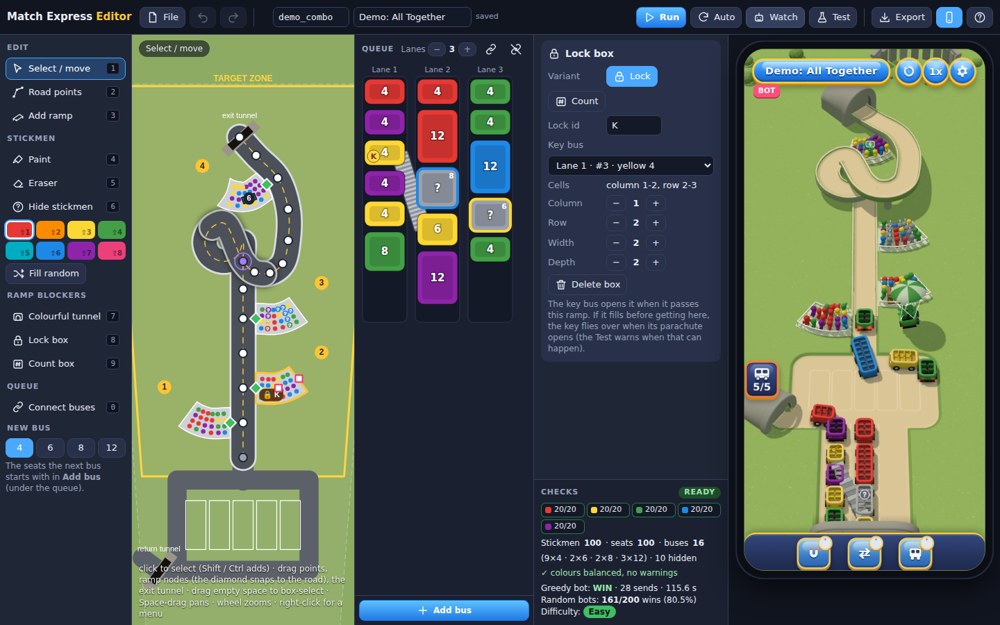

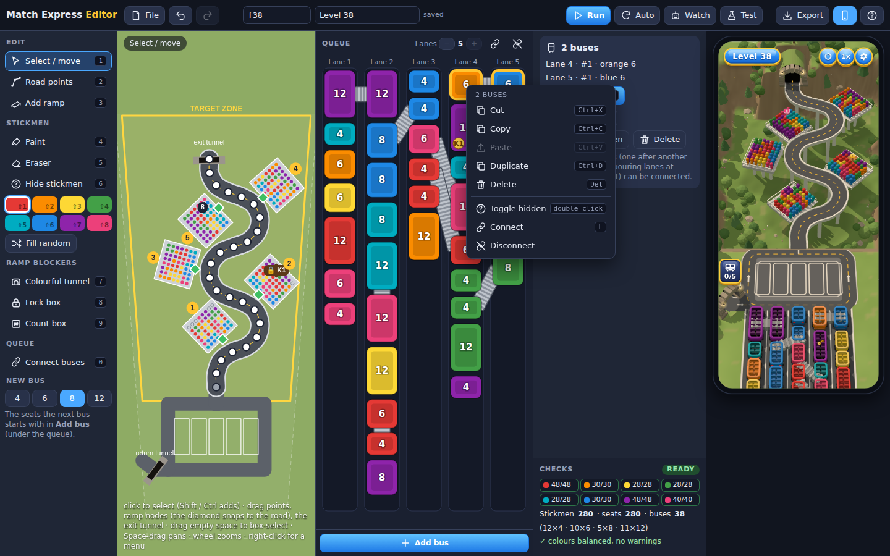
(`node tools/shoot-editor.js`)

- **Top toolbar:**
  - *File* (new, open: Levels & level order, save, save as, duplicate, import);
  - undo / redo;
  - the level's **id** and name, and whether it is saved (an orange dot and a ● in the
    tab title mark unsaved changes; every edit is also kept as a draft, so a reload
    picks up where you left off);
  - *Run*, *Auto*, *Watch*, *Test*;
  - *Export*;
  - show / hide the preview;
  - help.
- **Left tool panel:**
  - select / move, road points, add ramp;
  - paint, eraser, hidden-stickmen brush, with the 8 colours;
  - the ramp blockers: colourful tunnel, lock box, count box;
  - connect buses, plus the size for new buses.
- **Centre:** a top-down view you edit with the mouse or touch. The yellow frame is the
  target zone. Wheel (or a trackpad / touch pinch) zooms; Space-drag or the middle mouse
  button pans; *F* fits. Dragging over empty space draws a selection box. Whatever is
  under the pointer is highlighted, and the selection is outlined in yellow.
  Problems are circled in red with a short note next to them.
- **Queue pane:** 2 to 5 lanes (the − / + stepper), front at the top, drawn as buses
  whose length shows their size. The pane widens for 4 and 5 lanes.
- **Level card** (nothing selected): id, name, **role** (Tutorial, Teach, Practice,
  Challenge, Milestone, Relax, Fun, Finale…), **target difficulty** (1–10), queue lanes.
  Role and difficulty are design notes kept in the level's `meta`.
- **Right:** the **inspector** for the selection (level, road point(s), exit tunnel,
  ramp(s), tunnel(s), box(es), stickman cells, one bus or several). A problem with the
  selected thing is shown at the top of its card. Below: the **Checks**.
- **Far right:** the preview, the real game in a 390×844 phone frame.
- With no ramps the view says so, with an *Add ramp* button; an empty queue says
  "No buses yet – Add bus"; an empty lane has its own *+ Add*.

Every icon and menu entry has a tooltip or label with its shortcut. **?** opens the list.
**Right-click** anything (a point, the exit tunnel, a ramp, a blocker, stickman cells, a
bus, an empty lane, the ground) for a menu with the same actions.

Shortcuts use **Cmd** on a Mac and **Ctrl** elsewhere (both are accepted everywhere);
they replace the browser's own (Ctrl+S does not save the web page, Ctrl+D does not
bookmark it). Some browsers keep Ctrl+N / Ctrl+W for themselves in a normal tab; *File →
New level* always works.

| key | action | key | action |
|---|---|---|---|
| 1 … 9, 0 | tools: select, road, ramp, paint, eraser, hide, tunnel, lock, count, connect | Ctrl S | save |
| V P R B E H T K N | the same tools by letter | Ctrl Shift S | save as a new level |
| Shift 1 … 8 | pick a colour | Ctrl N | new level |
| L | connect the selected buses | Ctrl O | open (Levels & level order) |
| Ctrl Z | undo | Ctrl E / Ctrl Shift E | export level JSON / playable HTML |
| Ctrl Shift Z, Ctrl Y | redo | Ctrl Enter | run the preview |
| Ctrl C / X / V | copy / cut / paste | Ctrl D | duplicate |
| Del / Backspace | delete the selection | Ctrl A | select all of the current tool's things |
| Shift- / Ctrl-click | add to / remove from the selection | drag on empty space | box select |
| arrows | nudge (Shift: further) | Esc | deselect / close |
| Space-drag, middle mouse | pan | wheel, pinch | zoom |
| F | fit the view | ? | help |

What the selection commands work on:
- **Road points** (road tool, or click / box): copy-paste inserts the copies after the
  selection; arrows move them 0.1 (Shift 0.5); the first point stays fixed to the yard.
- **Ramps** (select tool): pasted copies board further along the road; arrows slide a
  ramp along the road (a loose one moves freely).
- **Tunnels and boxes** (their tools): pasted into the selected ramp, in a free column;
  arrows move them a cell.
- **Stickman cells:** drag a box over a ramp (select tool), or *Ctrl A* with a stickmen
  tool for a whole ramp; paste goes to the hovered cell or the selected ramp's first
  cell; arrows move them a cell; *Delete* empties them; their card paints or hides them.
- **Buses:** paste inserts after the selected bus; arrows up / down reorder, left / right
  move to the neighbouring lane.
- **The level:** with nothing selected, *Ctrl C* copies the whole level and *Ctrl D*
  duplicates it into the saved levels; in the Levels list the arrows pick a level,
  *Enter* opens it, *Ctrl D* duplicates it and *Del* deletes it. A level JSON on the
  system clipboard pastes in as a new saved level.
- Undo and redo bring back the selection with the level.

### The game, the preview and exports are independent
- The editor's changes never reach the game page or an exported file. `index.html`
  opens its built-in level (or `?level=<id>`, a bundled level). It never loads a level
  saved in the editor, and there is no channel between the editor and game tabs.
- The **preview** is the editor's own copy of the game (`index.html?embed=1` in an
  iframe, or an embedded copy in the single-file editor). It only plays levels the
  editor sends it.
- **RUN** restarts the preview fresh with the level being edited. **Auto** does the same
  500 ms after each edit; the timer restarts on every change, so a drag only restarts
  once you let go. Opening a level runs it at once.
- An **export** is a frozen snapshot. Editing or deleting the level later changes nothing
  in a file you already exported.

### Road
- With the road tool, click the road to insert a point; with either tool, drag a point
  to move it.
- Right-click for the point's menu (delete, spiral, copy…); long-press on touch deletes it.
- **Spiral** (point inspector) turns the point into a loop that crosses over itself,
  with an overpass and pillars. You can set its side.
- These parts are placed automatically:
  - the road start, at the entry road;
  - the exit tunnel, at the road end along the last tangent. It can sit anywhere in the
    target zone: drag it (the road's last point), nudge it with the arrows, or put it
    on the top edge with *Left / Centre / Right* in its card or menu;
  - the return tunnel, at the collector end on the side nearer the exit tunnel,
    facing the bays;
  - the pillars, evenly spaced.
- Warnings in Checks, also circled in red:
  - the road crosses itself outside a spiral;
  - a point is off screen;
  - a curve is too tight for a 12-seat bus.

### Ramps and their nodes
- **Add ramp** (R), then click next to the road. A ramp appears there, on that side, as
  a straight platform square to the road.
- A ramp is a straight rectangle with a regular grid of stickmen, and two **nodes**:
  - The **front node** (diamond) is its boarding point. Drag it along the road; it always
    snaps to the nearest road point, on the side of the road the pointer is on. A ramp
    is never off the road. A ramp square to the road stays square; a turned one keeps
    its angle to the road.
  - The ramp's whole **front edge lies flush on the road's edge**: straight along a
    straight road, bent with it on a curve, with a small apron in front of the first row.
    Moving the ramp or the road keeps it that way, in the game and the editor (the front
    follows its boarding point `at`).
  - The **back node** (square) turns the ramp. *Square to road* in the inspector (and
    the context menu) points it straight out again.
- The front row always faces the road, as close to the road's edge as the apron allows.
- The ramp inspector also sets columns and rows, flips the side, and has *Fill random*
  (runs of 1–3 per column from the colours already in the level), *Clear* and *Delete*.
- Stickmen:
  - paint them with the 8-colour palette;
  - empty a cell with the eraser;
  - the **hidden** brush turns stickmen into grey "?" ones and back.

### Blockers in the editor
- **Colourful tunnel** (T): pick a colour, then drag across ramp cells. The cells must not
  be in the front row. The tunnel takes them (they are emptied).
  - The inspector sets its colour, stickman count, position and size.
  - Its stickmen count toward that colour's total in Checks.
- **Lock box** (K) and **count box** (N): drag across ramp cells.
  - A lock box gets the next free lock id (`K1`, `K2`…). Pick its **key bus** in the
    inspector; the queue then shows the key on that bus. Checks warns until exactly one
    bus carries the key.
  - A count box has a number of completed buses. The inspector switches between the two
    variants.
- **One blocker per column** of a ramp. The tools refuse an overlap.
- Click a blocker to select it. *Delete* removes it, and removing a lock box also takes
  its key off the bus.

### Queue
- **Lanes:** 2 to 5 (the − / + stepper above the queue, or *Queue lanes* in the level
  card). Removing the last lane moves its buses to the lane before it. The level stores
  the count as `laneCount`.
- **Add bus** (under the queue, or *+ Add* in an empty lane) opens a small form: lane,
  colour, seats (4 / 6 / 8 / 12) and hidden. It stays open for adding several and
  remembers the last choice.
- Click to select. Shift-click (or Ctrl-click) adds to the selection; drag a box over
  empty queue space to select several.
- Drag within a lane or to another lane to reorder.
- Right-click for the bus menu (move to any lane, hidden, connect, copy, delete…).
- Double-click toggles **hidden**: a grey bus with a "?", its colour on the rim.
- **Connect:** select 2 or 3 buses and press **L** (or the link button). The buses must
  touch: one after another in a lane, or neighbouring lanes at most one place apart — any
  pair of neighbouring lanes, lanes 4 and 5 included. A shape the game can't send, or a
  group that would deadlock the queue, is refused. Problems with connections are listed
  above the queue and their buses get a dashed red rim.
- Connected buses are drawn joined by grey **bellows**, as in the game.
- The bus inspector sets colour, size, hidden, the key it carries, and disconnects it.

### Checks
Checks shows:
- stickmen against seats for each colour (tunnels included), green when they match and
  red when they don't;
- totals, the number of buses of each size, the number of hidden stickmen;
- every layout and blocker warning (click one to show it), among them the exit tunnel leaving the target zone
  or sitting on another stretch of the road (`exit-road`).

**Test** runs the greedy bot plus 200 random games in a background worker. It
reports:
- whether the greedy bot wins or fails;
- how many sends it took and the game time;
- the random bot's win rate;
- a difficulty label: Easy >45%, Medium 15–45%, Hard 5–15%, Very Hard <5%;
- a warning when a key bus filled up before its lock's ramp in any game.

**Watch** plays the greedy bot in the preview.

### Levels, ids and the level order
- Every level has a unique **id**, shown and edited in the toolbar. Ids use letters,
  digits, `_` and `-` (e.g. `lvl_001`).
  - Renaming a saved level renames it in the level order too.
  - An id that is already used, or has other characters, is refused.
  - *New level* takes the next free `lvl_###`.
- **Levels & level order** (O) has two parts:
  - **Saved levels**, listed by id: open, add to the order, duplicate, delete, plus new,
    save and import. The bundled levels and the seven blocker demos are seeded here once.
  - **Level order:**
    - add an id (typed, or with the button in the list);
    - drag rows to reorder, or remove them;
    - unknown and duplicate ids are marked red with a warning;
    - export and import the order as JSON.
- The editor also keeps an autosaved draft, so a reload doesn't lose work.

```js
{ "type": "match-express-level-order", "version": 1, "levels": ["demo_hidden_bus", "lvl_001", ...] }
```

### Export
- **Level JSON:** the level with its id, as `<id>.json`. *Import* reads it back. Old
  format 1 levels get the default layout. A clashing id is renamed to the next free one.
- **Playable HTML: this level** or **the level order.** One self-contained file: the
  game, three.js and a frozen copy of the levels. It opens with a double-click, offline.
  - It starts at level 1 and shows *Level 1 / N*.
  - Winning offers **Next level**. After the last level, an **All levels complete**
    screen offers *Play again*.
  - The settings menu jumps to any level of the pack.
  - An order with warnings is not exported.
- **Play this level in a new tab:** the same packed file, opened from memory.

Level format 2:

```js
{ format: 2, id?, name, seed,
  road:  { points: [{x, z, spiral?: {r, side}}], tail? },
  ramps: [{ cp | at | front: [x, z], side, tilt?, shape?: [[x, z], ...], rows,
            columns: [["red", "?blue", null, ...], ...],
            tunnels?: [{ col, row, w, h, color, count }],
            boxes?:   [{ col, row, w, h, lock: "K1" } | { col, row, w, h, count: 3 }] }],
  lanes: [[{ color, cap, hidden?, link?, key? }, ...], [...], [...]] }
```

`front` (instead of `cp` / `at`, from older levels) is a ramp placed by a point: it snaps to
the nearest road point, on that side. `push` (an old offset of the front node from the road)
is ignored: every ramp's front edge lies on the road edge. Blocker cells are counted from the front of the
ramp: `col` / `row` is the cell nearest the road, `w` columns wide and `h` rows deep.

`tilt` (degrees) makes a straight platform leaving the road at that screen angle,
outward and up. Without `tilt` or `shape` a ramp gets the original curved default.
In `columns`, each list is one column, front cell first. `"?colour"` is a hidden
stickman and `null` is an empty cell. Each lane lists its front bus first.

## Single-file versions (double-click, no server)

```
node tools/build-standalone.js
```

This writes four files to `dist/`. Each one works when you open it straight from disk,
with no internet connection (three.js is inlined from `vendor/`):
- **`match-express-game.html`** is the game with `shared/core.js`, `shared/sync.js`
  and three.js inlined.
- **`match-express-editor.html`** is the editor with everything inlined. It carries the
  packed game, which serves as its preview (`iframe srcdoc`) and as the template for its
  exports. RUN, Auto, Watch and every export work as usual.
- **`match-express-play.html`** and **`match-express-crowded-rush-curve.html`** are
  share files. They open with Level 2 and with Crowded Rush Curve.
  - Neither loads a saved (or sent) editor level, and neither runs the background bot
    test.
  - Their settings menu plays each bundled level.

These files, the blocker demo pack and the 40-level funnel file below, are committed (the rest of `dist/` stays
ignored), so they can be downloaded straight from GitHub. On a file page, use *Download
raw file*, or save one of these links:
- [match-express-editor.html](https://github.com/bhanyagici/Prototype1/raw/claude/sweet-einstein-si64t3/match-express/dist/match-express-editor.html)
- [match-express-play.html](https://github.com/bhanyagici/Prototype1/raw/claude/sweet-einstein-si64t3/match-express/dist/match-express-play.html)

After changing the game or the editor, run `node tools/build-standalone.js` again and
commit `dist/`.

## Blockers

Seven demo levels (`levels/demo_*.json`, made by `node tools/make-demos.js`) show the
blockers one at a time and then together. They are under *Blocker demos* in the game's
settings and in the editor's level list.

| blocker | where | rule |
|---|---|---|
| **Hidden bus** | queue, `hidden: true` | Grey with a "?", but its length shows its capacity. It reveals its colour when it becomes the front of its lane. A hidden member of a connected group, sent from behind, reveals when it joins the main road. |
| **Connected buses** | queue, the same `link` on 2–3 buses | See *Connected buses* below. |
| **Colourful tunnel** | ramp, `tunnels` | Covers `w × h` empty cells. Whenever a cell directly in front of it empties, it releases one of its `count` stickmen (its colour) into it, in every column it spans. Stickmen behind it wait; at 0 it disappears and they flow forward. Its stickmen count toward the colour totals. |
| **Hidden stickmen** | ramp, `"?colour"` cells | Grey with a "?" until they reach the front row. |
| **Lock box** | ramp, `boxes` with `lock`, and one bus with the same `key` | A crate over a block of cells. Its stickmen cannot board and block those behind. The key bus shows a key, also in the queue. When it passes the ramp's boarding point, the key flies to the lock and the crate lifts away. If the key bus fills and jumps off first, the key flies over when its parachute opens (`KEY_FALLBACK_DELAY`). The bot test warns when that can happen. |
| **Count box** | ramp, `boxes` with `count` | A crate showing how many more buses must be completed (filled and gone) since the start. At 0 it opens. |

**Connected buses** are drawn as one articulated bus, with accordion bellows between the
rear of each bus and the front of the next. In the queue and the bays the bellows stretches
across lanes or bays.
- **Shape:** links can be vertical (one after another in a lane), horizontal (neighbouring
  lanes) or diagonal (neighbouring lanes, one row apart).
- **Sending:** a group can go only when, in every lane it uses, its topmost member is the
  front bus. A member at the front waiting for its partners blocks its lane. Tapping any
  sendable member sends the whole group. The road must have room for all of them, and each
  member counts on the road counter.
- **On the road:** the leftmost lane's bus leads, then left to right, front to back within
  a lane. The members keep one fixed gap and the whole group stops while any member boards.
  Each member boards its own colour; a full member stops boarding but stays in the group.
- **Jumping and returning:** when all members are full, they jump off together. Otherwise
  the whole group goes round, full members included, and parks in the leftmost free bays,
  not necessarily next to each other. With fewer free bays than members, the level is lost.
  Tapping a parked member sends the whole group back (room permitting).

**Checker rules:**
- colour totals include tunnels;
- every lock has exactly one key bus, and every key a lock;
- count boxes between 1 and the number of buses;
- groups of 2–3 that touch, and no two groups waiting for each other (`link-deadlock`);
- one blocker per column, inside the ramp, a tunnel on empty cells with a cell in front;
- ramps that fold on a bend, overlap the road, another ramp or the exit tunnel (`ramp-*`).

**Cheering with blockers.** At send time the prediction replays tunnels feeding their
stickmen, and the locks a key bus is sure to open on its way. A box that opens any other
way (a key bus that filled first, or a count box) is a new event. Then every bus on its
lap is planned again, so buses ahead may now reach stickmen that were locked away. Stickmen
who stay with the same bus keep cheering.

### Blocker screenshots and the demo pack

`node tools/shoot-blockers.js` plays each demo in the game at 390×844. It saves one shot
at the start and one at the moment the blocker acts, chosen by the greedy bot:
- a hidden bus revealed at its lane front;
- a connected group on the road;
- a tunnel releasing stickmen;
- hidden stickmen;
- a key flying to its crate;
- a count box opening;
- all of them together.

| | start | in action |
|---|---|---|
| hidden bus | 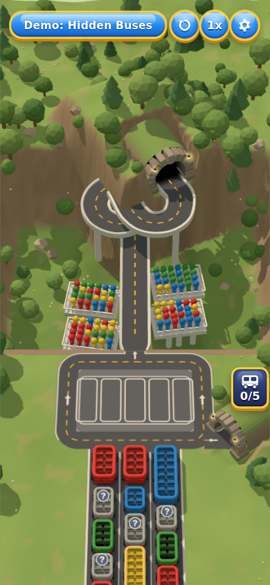 | 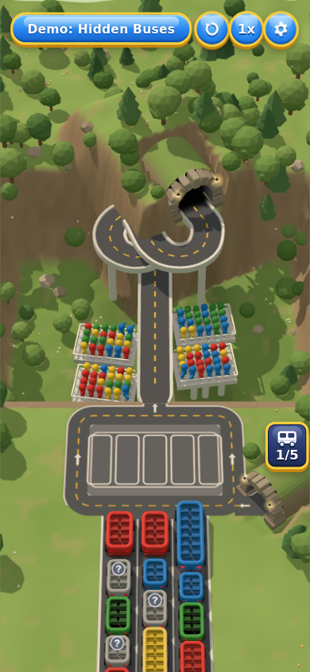 |
| connected buses | 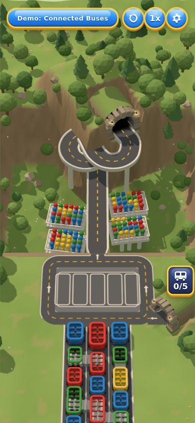 | 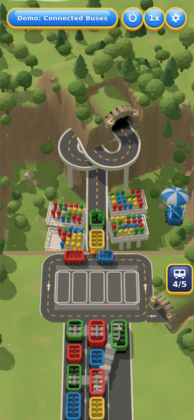 |
| colourful tunnel | 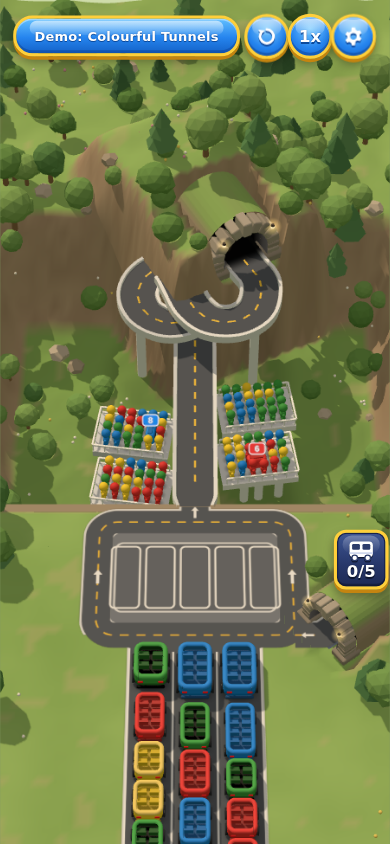 | 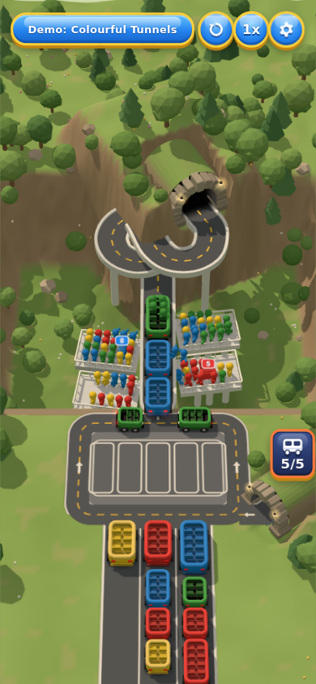 |
| hidden stickmen | 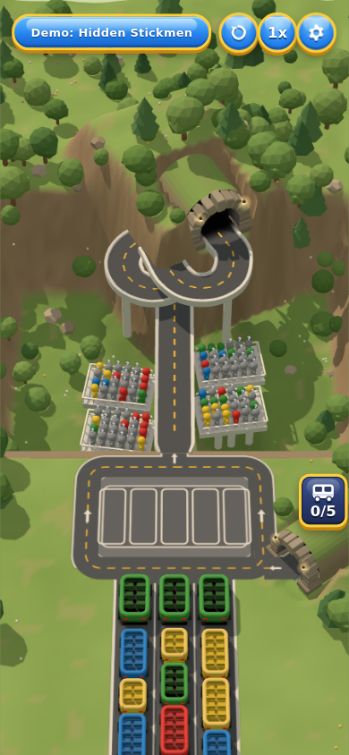 | 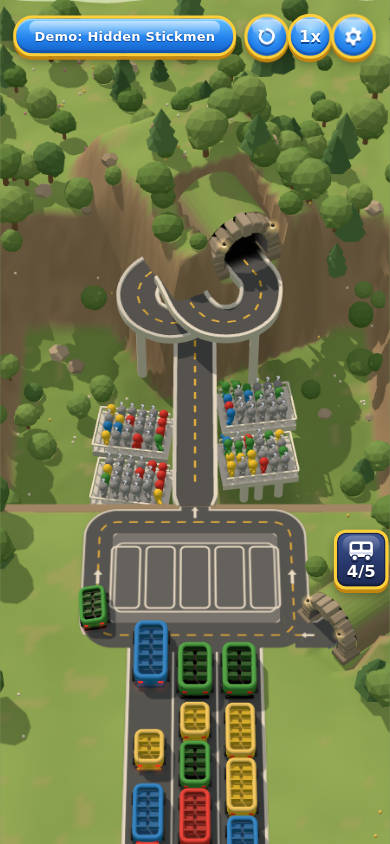 |
| lock & key | 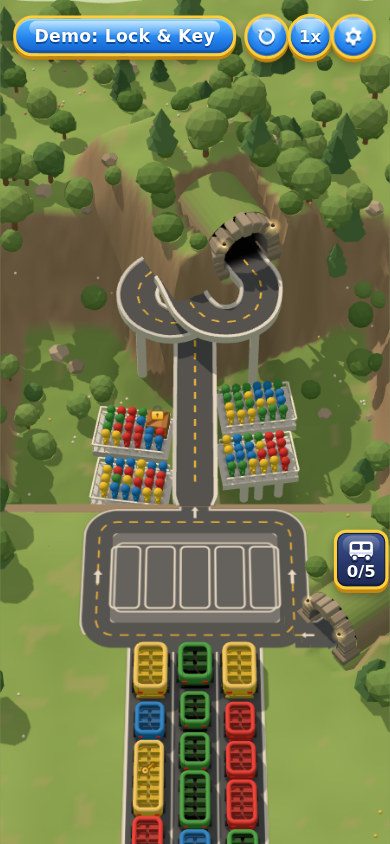 | 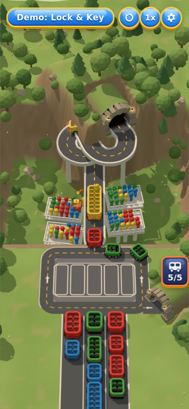 |
| count box | 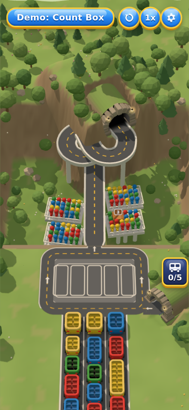 | 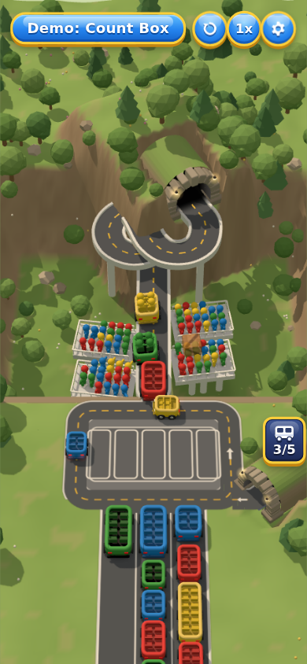 |
| all together | 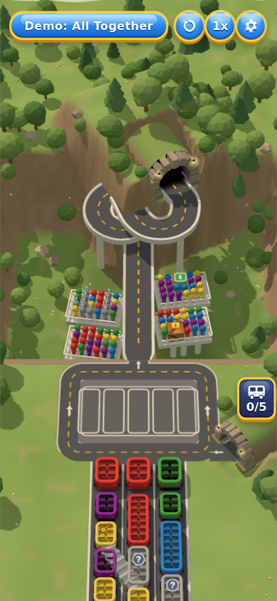 | 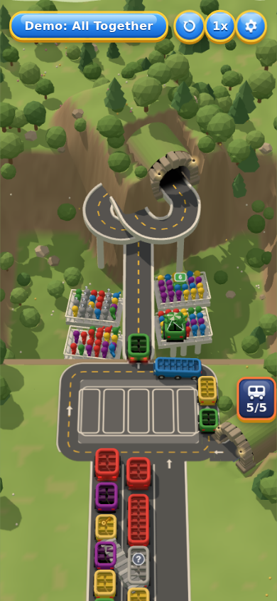 |

`node tools/export-demo-pack.js` makes the demo pack through the editor's own UI. It types
the seven demo ids into the Level Order panel
([screenshot](screenshots/editor-level-order.png)), then clicks *Export order JSON* and
*Playable HTML*:
- `levels/demo-level-order.json` is the order;
- `dist/match-express-blocker-demos.html` is the pack (committed, like the other single
  files).

The tool then opens the pack from `file://` at 390×844 and lets the greedy bot play it.
It wins all seven levels in order and ends on the *All levels complete* screen, with no
network request. Screenshots:
- [level 1 of 7](screenshots/pack-level-1.png);
- [a win offering the next level](screenshots/pack-level-complete.png);
- [the end](screenshots/pack-all-complete.png).

## The 40-level funnel

Forty levels for a first-session funnel, built from a design table (role, target difficulty 1–10, queue
lanes, ramps, colours, stickmen, bus sizes, blockers, road and ramp idea per level):
- `levels/funnel/f01.json` … `f40.json`, the order `levels/funnel/funnel-order.json`, and the measured data
  `funnel-report.json` (tuning) and `funnel-bots.json` (the bot table);
- **`dist/match-express-funnel-40.html`**: all 40 levels in one file (double-click, no server, no network);
- **`dist/funnel.xlsx`**: the funnel sheet, the curves and a summary (opens in Google Sheets).

Download: [match-express-funnel-40.html](https://github.com/bhanyagici/Prototype1/raw/claude/sweet-einstein-si64t3/match-express/dist/match-express-funnel-40.html) ·
[funnel.xlsx](https://github.com/bhanyagici/Prototype1/raw/claude/sweet-einstein-si64t3/match-express/dist/funnel.xlsx) ·
[funnel-order.json](https://github.com/bhanyagici/Prototype1/raw/claude/sweet-einstein-si64t3/match-express/levels/funnel/funnel-order.json)

```
node tools/make-funnel.js                 # roads, ramps, content, tuning -> levels/funnel (about 8 minutes on 4 cores)
FUNNEL_PASS=2 node tools/make-funnel.js --refine   # more candidates per level (passes 1 and 2 were run)
node tools/make-funnel.js --search 6 8 16 # the lane retune: saved roads and ramps kept, content made again
FUNNEL_PASS=2 node tools/make-funnel.js --search 6 8   # another pass; the saved level stays unless beaten
node tools/make-funnel.js --measure 7 11  # saved levels unchanged, measured again (meta from the design table)
node tools/funnel-bots.js                 # the bot table -> levels/funnel/funnel-bots.json
python3 tools/make-funnel-xlsx.py         # -> dist/funnel.xlsx (then recalculate, e.g. LibreOffice)
node tools/build-funnel.js                # -> dist/match-express-funnel-40.html
node tools/shoot-funnel.js                # -> screenshots/funnel/
```

### How a level is made

- **Road** (`tools/funnel/geometry.js`): a turtle program per level: straights, turns on a minimum
  radius, spirals (`S`); heights climb gently and rise over each spiral's crossing.
- **Ramps**: a shape per ramp: straight out, diagonal, curved arc, L, fan (columns spreading toward the back)
  or wedge (drawing together). Two new ramp fields in the core: `spread` (fan / wedge) and `push` (a turned
  ramp's front edge kept clear of the road). A solver finds a spot along the road inside the target zone,
  clear of the road, the exit, spirals and the other ramps (real outlines, a new `ramp-fold` check for bent
  ramps and a `ramp-exit` check for the tunnel mouth).
- **Content** (`tools/funnel/content.js`): the buses, an intended send order (the plan), then the columns
  filled front-to-back following the plan, so the plan always works; the lanes are dealt from the plan. One
  knob, hardness `h`, sets how forgiving the level is for out-of-order play: same-colour run lengths, how far
  the lanes drift from the plan, and "trap" buses (colours still buried at the start) at the lane heads.
  Tunnels, lock boxes, connected groups and hidden buses are placed against the plan.
- **Tuning** (`tools/make-funnel.js`): only the stickmen order in the columns, the bus order and sizes in the
  lanes and the blocker placement change. Bisection on `h`, then two refine passes of more (h, seed)
  candidates; the greedy bot must win and no cheering prediction may miss. Among in-band candidates the longer
  greedy game wins (playtime).
- **Queue lanes**: 2 lanes on 1–5, 9, 22 and 31; 4 on 16, 20, 23 and 35; 5 on 38 and 40; 3 on all others
  (25–30 always 3). The 4- and 5-lane levels carry 6–14 connected groups, most of them across neighbouring
  lanes. The lane retune (`--search`) kept every level's road and ramps and made only the content again:
  many (h, seed, group count) candidates with a quick 50-game estimate, the nearest few checked with 200.
- **Levels 1–5 cannot be lost**: enough colours sit in whole columns of their own that at most 5 buses could
  ever come back unfilled; each was played 1000 times by the random bot and by an adversarial bot without a loss.

### Ramp changes (did not fit the target zone at the fixed camera)

The stickmen counts stayed; these ramps changed proportion or shape:
- level 18, ramp 3: the L shape did not fit, built as a diagonal;
- level 35, ramp 1: 10x6 did not fit, built as 12x5 (60 cells, as before);
- level 40, ramp 3: straight did not fit, built as a diagonal;
- level 40, ramp 6: 8x6 did not fit, built as 4x12 (48 cells, as before).

### Difficulty, measured

Random-bot win rate over 200 games (the target bands: 1–2 ≥ 70%, 3: 55–75%, 4: 45–60%, 5: 35–50%,
6: 25–40%, 7: 18–30%, 8: 12–22%, 9: 8–15%). Challenge, Milestone, Finale and Practice levels must land in
their band; Relax, Fun and Teach levels may be easier. Measured diff places the win rate on the same scale
(band centres, a straight line between them). The greedy bot wins all 40; levels 1–5 cannot be lost.

| Lv | Role | Lanes | Blockers | Target diff | Band | Random wins / fails / unfinished | Win rate | Measured diff | In band | Greedy 1x | Greedy 2x |
|---|---|---|---|---|---|---|---|---|---|---|---|
| 1 | Tutorial | 2 | - | 1 | ≥ 70% | 200 / 0 / 0 | 100.0% | 1.0 | yes | 13.5 s | 6.7 s |
| 2 | Teach | 2 | - | 2 | ≥ 70% | 200 / 0 / 0 | 100.0% | 1.0 | yes | 17.9 s | 9.0 s |
| 3 | Tutorial (bay re-send) | 2 | - | 2 | ≥ 70% | 200 / 0 / 0 | 100.0% | 1.0 | yes | 38.7 s | 19.4 s |
| 4 | Teach (bus sizes) | 2 | - | 3 | 55–75% | 200 / 0 / 0 | 100.0% | 1.0 | easier (allowed) | 33.8 s | 16.9 s |
| 5 | Fun | 2 | - | 2 | ≥ 70% | 200 / 0 / 0 | 100.0% | 1.0 | yes | 33.9 s | 17.0 s |
| 6 | Challenge | 3 | - | 5 | 35–50% | 197 / 3 / 0 | 98.5% | 1.1 | **no** | 71.9 s | 35.9 s |
| 7 | Teach + POPUP | 3 | 5 hidden buses | 3 | 55–75% | 200 / 0 / 0 | 100.0% | 1.0 | easier (allowed) | 46.1 s | 23.1 s |
| 8 | Practice | 3 | 2 hidden buses | 5 | 35–50% | 184 / 16 / 0 | 92.0% | 1.5 | **no** | 63.9 s | 31.9 s |
| 9 | Relax | 2 | - | 3 | 55–75% | 200 / 0 / 0 | 100.0% | 1.0 | easier (allowed) | 65.3 s | 32.6 s |
| 10 | Milestone | 3 | 3 hidden buses | 6 | 25–40% | 120 / 80 / 0 | 60.0% | 3.4 | **no** | 91.2 s | 45.6 s |
| 11 | Relax | 3 | - | 3 | 55–75% | 145 / 55 / 0 | 72.5% | 2.6 | yes | 75.6 s | 37.8 s |
| 12 | Challenge | 3 | 2 hidden buses | 6 | 25–40% | 123 / 77 / 0 | 61.5% | 3.3 | **no** | 77.3 s | 38.6 s |
| 13 | Teach + POPUP | 3 | 4 connected pairs | 3 | 55–75% | 200 / 0 / 0 | 100.0% | 1.0 | easier (allowed) | 75.4 s | 37.7 s |
| 14 | Practice | 3 | 6 connected pairs | 6 | 25–40% | 77 / 123 / 0 | 38.5% | 5.4 | yes | 105.4 s | 52.7 s |
| 15 | Fun | 3 | - | 3 | 55–75% | 200 / 0 / 0 | 100.0% | 1.0 | easier (allowed) | 53.0 s | 26.5 s |
| 16 | Challenge | 4 | 2 hidden buses, 6 connected pairs | 7 | 18–30% | 44 / 156 / 0 | 22.0% | 7.3 | yes | 132.2 s | 66.1 s |
| 17 | Teach (no popup, short hint) | 3 | 3 connected triples | 4 | 45–60% | 179 / 21 / 0 | 89.5% | 1.7 | easier (allowed) | 116.7 s | 58.3 s |
| 18 | Relax | 3 | - | 3 | 55–75% | 200 / 0 / 0 | 100.0% | 1.0 | easier (allowed) | 70.7 s | 35.3 s |
| 19 | Practice | 3 | 2 connected pairs, 2 connected triples | 6 | 25–40% | 55 / 68 / 77 | 27.5% | 6.6 | yes | 136.8 s | 68.4 s |
| 20 | Milestone | 4 | 2 hidden buses, 1 connected pair, 6 connected triples | 8 | 12–22% | 40 / 160 / 0 | 20.0% | 7.6 | yes | 161.3 s | 80.6 s |
| 21 | Teach (combo, no popup) | 3 | 3 hidden buses, 6 connected pairs | 5 | 35–50% | 197 / 3 / 0 | 98.5% | 1.1 | easier (allowed) | 94.1 s | 47.0 s |
| 22 | Relax | 2 | 1 hidden bus | 3 | 55–75% | 200 / 0 / 0 | 100.0% | 1.0 | easier (allowed) | 72.8 s | 36.4 s |
| 23 | Challenge | 4 | 3 hidden buses, 6 connected pairs, tunnel (orange, 8) | 7 | 18–30% | 43 / 17 / 140 | 21.5% | 7.4 | yes | 119.5 s | 59.8 s |
| 24 | Fun | 3 | 2 connected pairs | 4 | 45–60% | 200 / 0 / 0 | 100.0% | 1.0 | easier (allowed) | 95.6 s | 47.8 s |
| 25 | Challenge | 3 | 3 hidden buses, 3 connected triples, tunnel (green, 8) | 8 | 12–22% | 33 / 41 / 126 | 16.5% | 8.1 | yes | 228.7 s | 114.4 s |
| 26 | Teach + POPUP | 3 | tunnel (blue, 6), tunnel (purple, 6), tunnel (blue, 6) | 3 | 55–75% | 200 / 0 / 0 | 100.0% | 1.0 | easier (allowed) | 82.0 s | 41.0 s |
| 27 | Practice | 3 | 2 hidden buses, tunnel (green, 8), tunnel (orange, 8) | 6 | 25–40% | 51 / 149 / 0 | 25.5% | 6.8 | yes | 139.7 s | 69.8 s |
| 28 | Relax | 3 | tunnel (yellow, 6), tunnel (green, 6) | 3 | 55–75% | 200 / 0 / 0 | 100.0% | 1.0 | easier (allowed) | 78.6 s | 39.3 s |
| 29 | Challenge | 3 | 2 hidden buses, 2 connected pairs, tunnel (blue, 8), tunnel (red, 8) | 7 | 18–30% | 56 / 18 / 126 | 28.0% | 6.5 | yes | 123.2 s | 61.6 s |
| 30 | Milestone | 3 | 3 hidden buses, 6 connected triples, tunnel (cyan, 8), tunnel (cyan, 8) | 9 | 8–15% | 24 / 119 / 57 | 12.0% | 8.9 | yes | 255.4 s | 127.7 s |
| 31 | Relax | 2 | 2 hidden buses | 3 | 55–75% | 200 / 0 / 0 | 100.0% | 1.0 | easier (allowed) | 73.2 s | 36.6 s |
| 32 | Teach + POPUP | 3 | 2 lock boxes & keys | 4 | 45–60% | 200 / 0 / 0 | 100.0% | 1.0 | easier (allowed) | 93.6 s | 46.8 s |
| 33 | Practice | 3 | 2 hidden buses, 2 lock boxes & keys | 6 | 25–40% | 69 / 131 / 0 | 34.5% | 5.8 | yes | 147.2 s | 73.6 s |
| 34 | Fun | 3 | 5 connected pairs, tunnel (blue, 6), tunnel (blue, 6) | 4 | 45–60% | 180 / 20 / 0 | 90.0% | 1.7 | easier (allowed) | 126.9 s | 63.4 s |
| 35 | Challenge | 4 | 2 hidden buses, 13 connected pairs, 2 lock boxes & keys | 8 | 12–22% | 30 / 170 / 0 | 15.0% | 8.4 | yes | 225.8 s | 112.9 s |
| 36 | Relax | 3 | 1 hidden bus, lock & key | 4 | 45–60% | 200 / 0 / 0 | 100.0% | 1.0 | easier (allowed) | 101.8 s | 50.9 s |
| 37 | Practice | 3 | 3 hidden buses, 7 connected pairs, tunnel (red, 8), tunnel (purple, 8) | 7 | 18–30% | 47 / 138 / 15 | 23.5% | 7.1 | yes | 242.1 s | 121.0 s |
| 38 | Challenge | 5 | 2 hidden buses, 11 connected pairs, tunnel (pink, 8), 2 lock boxes & keys | 8 | 12–22% | 26 / 169 / 5 | 13.0% | 8.7 | yes | 215.3 s | 107.6 s |
| 39 | Fun | 3 | 8 connected pairs, tunnel (blue, 6), tunnel (blue, 6) | 5 | 35–50% | 200 / 0 / 0 | 100.0% | 1.0 | easier (allowed) | 132.6 s | 66.3 s |
| 40 | Finale | 5 | 3 hidden buses, 4 connected pairs, 4 connected triples, tunnel (purple, 8), tunnel (purple, 8), 2 lock boxes & keys | 9 | 8–15% | 20 / 180 / 0 | 10.0% | 9.1 | yes | 294.2 s | 147.1 s |
| | **Total** | | | | | | | | **19 / 40** (must-land: 14 / 18) | **73.7 min** | **36.9 min** |

**Out of band, closest version kept (4 levels).** The tuning may only change the stickmen order in the
columns, the bus order and sizes in the lanes and the blocker placement; the search passes (up to 240
candidates each, the best checked over 200 games) got these as close as they go:
- **6 (98.5%), 8 (92.0%), 10 (60.0%), 12 (61.5%)**: small or medium 3-lane levels without
  connected buses. Under the current rules (5 on the road, 5 bays, unlimited re-sends) the random bot only
  loses when 6 unfilled buses are out at once; a bus sent out of order still takes whatever stickmen of its
  colour are open, and parked buses are re-sent as often as lane buses, so the bays drain. Connected groups
  are what make a level hard (a returning group needs a free bay for every member), and these levels have
  none in their design row.
- **Level 4** (band 55–75%) is fail-free by the rule "no fail before level 6", so it is at 100% (allowed:
  a Teach level may be easier).

**Unfinished games.** On the levels with connected groups many random games end without a result
(the "unfinished" column): the bot keeps re-sending half-full buses, so the road never has room for a
connected pair or triple. That is not a dead end for a player, who can wait for the road to clear (the
core's no-deadlock rule holds); under the agreed metric it counts as "not won". Wins / fails /
unfinished are listed separately here and in the spreadsheet. On level 20, for example, the random bot
never fails and 158 of 200 games stay unfinished, so a person will find it easier than its 21% suggests.

**Exit tunnels out in the open.** On the levels whose road ends heading down toward the yard (7, 11, 17, 28,
36) the exit tunnel sits in its own mound mid-screen: the hill stops short of the yard plateau, the tunnel's
roof shell has a closed rock end, and its rock sides now reach down to the ground (a tunnel whose hill gives way
to the road nearby stands as a rock outcrop instead of floating over the canyon). The tunnel's darkening ends at
its back end, so a road beyond it stays lit. Levels 25 and 35 ended with the tunnel sitting on the road's own
climb (a new checker warning, `exit-road`, flags that); their roads now turn outward after the last point and
end in the side hillside (4 units longer; still 20.5% and 18.0%, in band).

### Tutorials, popups and the hint

They come from each level's `meta` (`tutorial`, `tutorialLane`, `popup`, `hint`), which the core now keeps
through `normalizeLevel` (and so the editor keeps it too):
- **Level 1**: a hand pointer and a short tip. Tap the bus whose colour matches the front row → watch the
  stickmen board → a full bus leaves with a parachute → the next bus. While the hand shows (and while the
  stickmen board), taps on other buses do nothing.
- **Level 3**: built so the first bus (the hand's) can reach only half of its stickmen: it comes back and parks.
  Once its colour is at a front again (and the road has room), the hand points at the parked bus: parked
  buses can be sent back.
- **Intro popups** on the first appearance of a blocker: level 7 Hidden Bus, 13 Connected Buses, 26 Colorful
  Tunnel, 32 Lock & Key. Title, one sentence, a small looping picture and OK; the game waits behind it. Seen
  popups are remembered (`localStorage`, key `me-intro-seen`). Combination levels have none.
- **Level 17**: a short hint about triple connected buses, for 5.5 s, that does not stop the game.

### The 40-level file

`window.ME_SHARE` turns on two extras for this pack (other packs are unchanged):
- **nav**: Previous and Next buttons around a "Level x / 40" title pill; a won level moves on to the next
  one by itself after a 3.5 s countdown on its Next button (Replay stops it).
- **stats**: per level the completion time (game seconds of the first win, so 2x does not halve it), the fail
  count and the second of each fail, saved in `localStorage` (`me-stats:funnel-40`). The Stats panel lists
  all 40 levels; *Export CSV* saves `match-express-stats.csv`
  (`level,id,name,completion_s,fails,fail_seconds,wins`); *Reset stats* asks for a second tap. The bot's games
  (B key) are not counted.

| | | |
|---|---|---|
| level 1 (tutorial) | level 7 | level 13 |
| 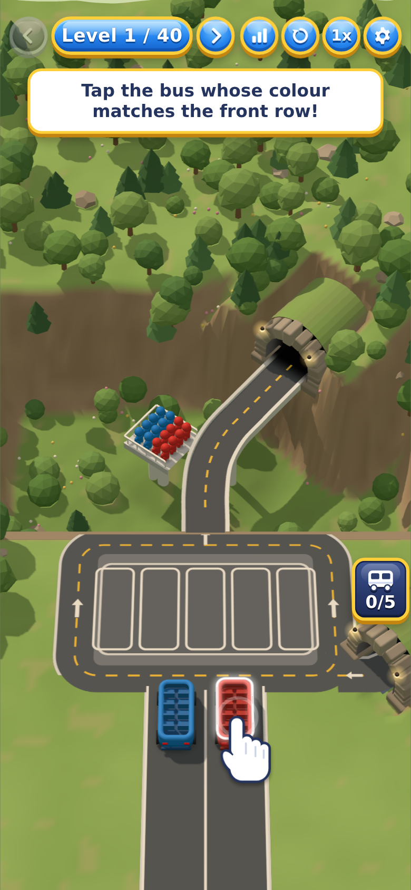 | 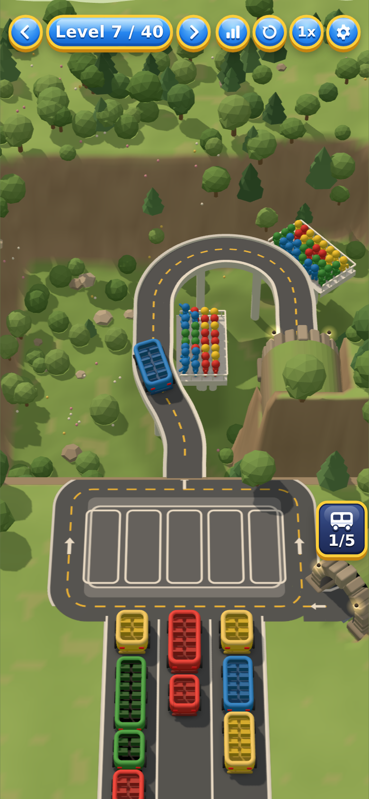 | 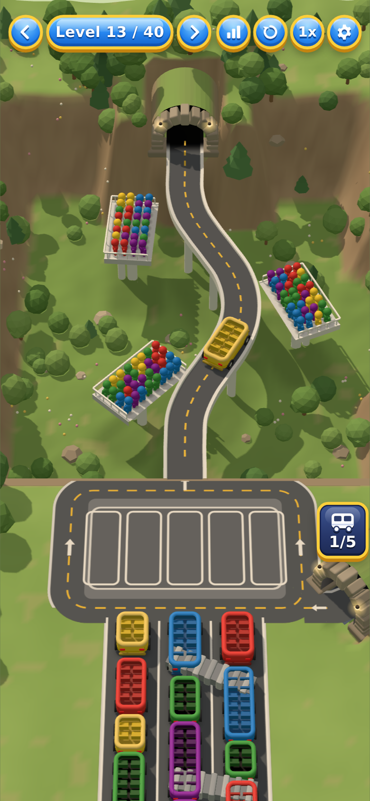 |
| level 15 | level 20 | level 26 |
| 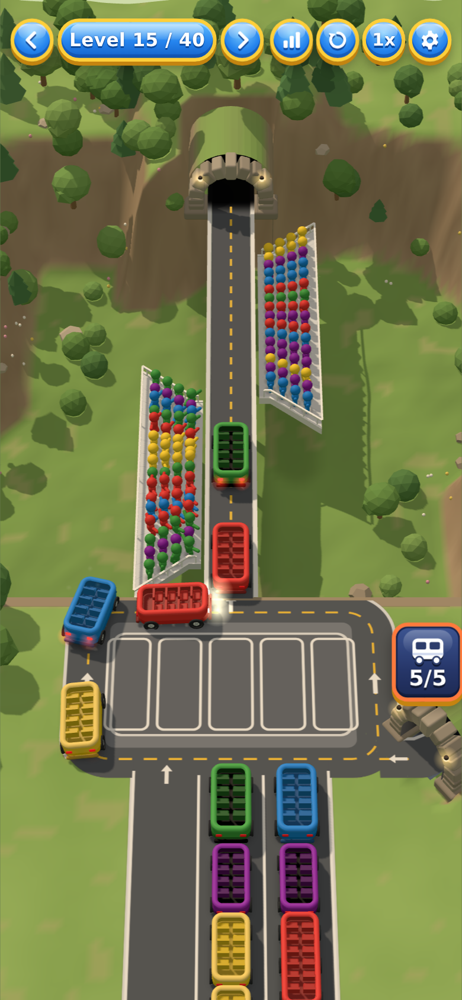 | 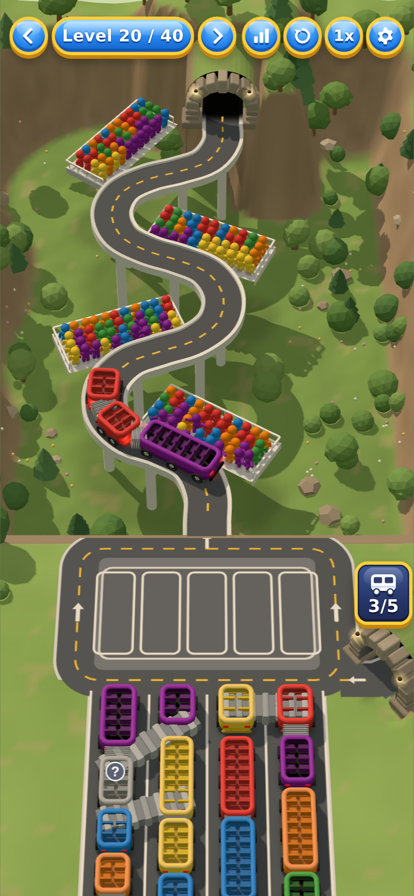 | 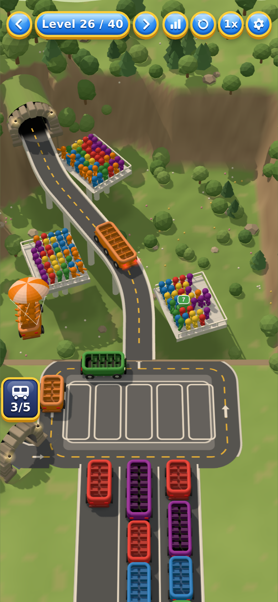 |
| level 30 | level 32 | level 40 |
| 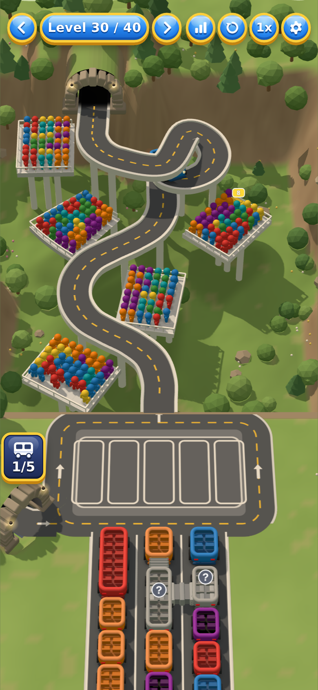 | 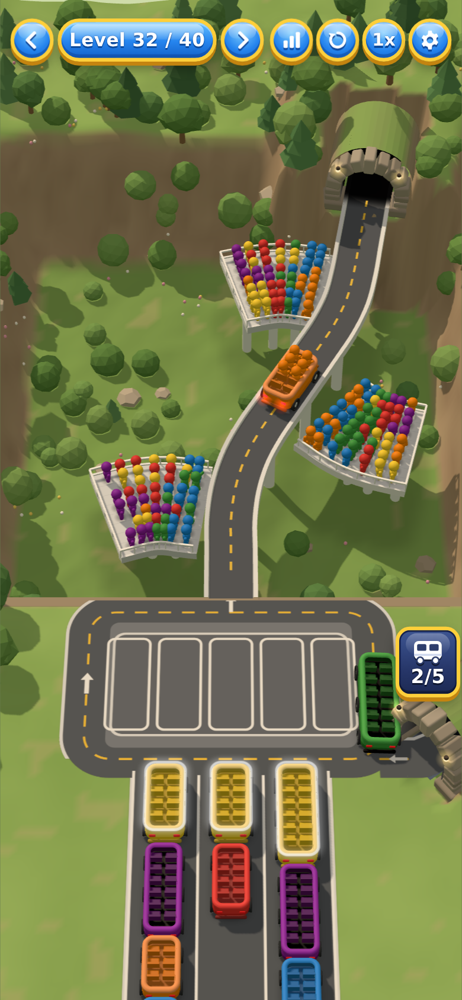 | 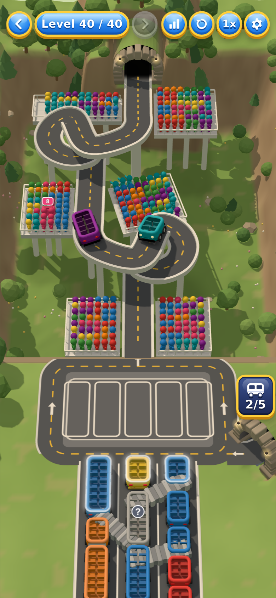 |
| the Hidden Bus popup | the Stats panel | |
| 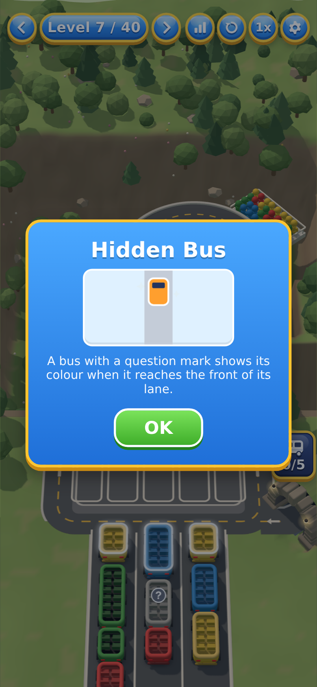 | 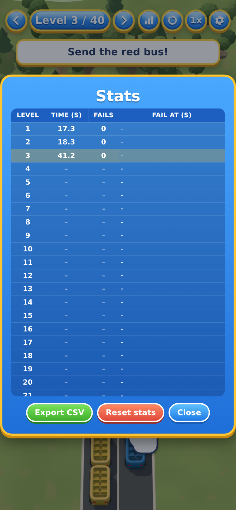 | |
| 2 lanes (level 9) | 4 lanes (level 35) | 5 lanes (level 38) |
| 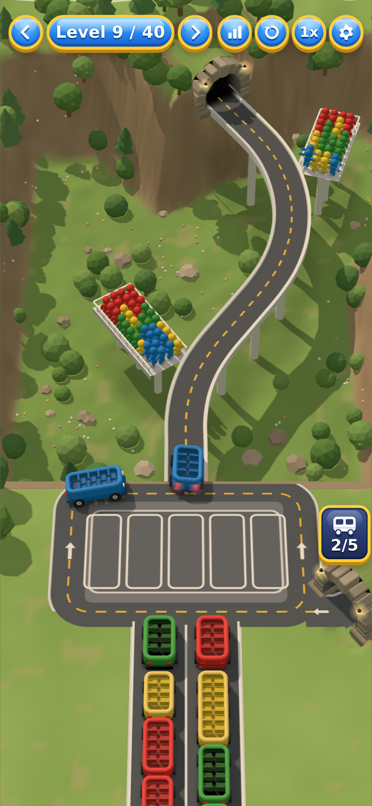 | 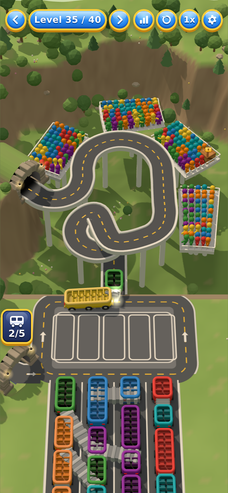 | 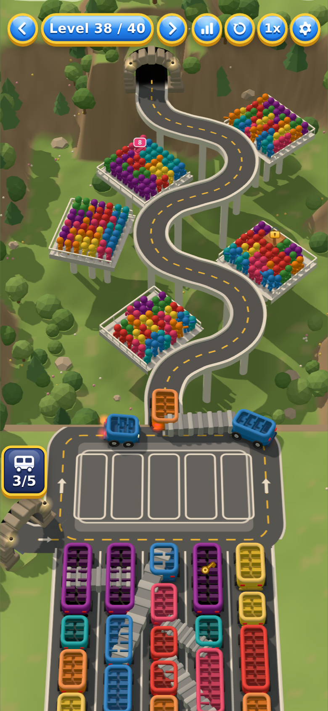 |

## Speed, sound, animation

- **1x / 2x** (top right, next to settings) sets one global time scale for the
  simulation, the animations, the particles and the timers. "2x" is highlighted when
  it is on. Sounds keep their pitch. The headless bots and the tests always run at
  1x.
- **Sound** is synthesised with WebAudio:
  - pops rise in pitch along a boarding chain and reset after it;
  - each bus has an engine hum that follows its speed;
  - also: a soft brake squeak, a horn when a bus fills, a whoosh when the parachute
    opens, an echo in the tunnel and a soft warning thud;
  - a forest ambience of wind and birds plays underneath;
  - every sound is layered and its pitch varies a little.

  Settings → *Sound* mutes it, and the choice is remembered.
- **Buses** are chunky toy buses, one colour each, with lighter and darker trims of
  that colour:
  - a rounded boxy body with a darker lower band and a thick rounded rim around the
    open top;
  - small round headlights and a rounded bumper at the front, red tail lights at the
    back;
  - fat dark wheels that peek out at the sides;
  - inside, the floor, seats and inner walls are in a darker shade.

  The body is one profile swept around a rounded rectangle. The front and back caps
  stay the same size, and only the middle stretches with capacity.
- **Stickmen** are chunky toy figures with no face:
  - a big round head (40% of their 0.78 height) and a short rounded body;
  - thick rounded arms and legs, as three instanced meshes (bodies, arms, legs).

  They swing their arms and legs when they run. Seated in a bus, only the head and
  shoulders show above the seat back.
- **Tunnels** (top exit and return) are built the same way:
  - a stone arch of chunky blocks on a thick base, with two warm lamps that pulse
    when a bus passes;
  - a dark interior that fades to black, with the road running into it;
  - a grassy roof mound behind the arch.

  The arch is aligned with the road direction at the mouth. A bus fades into the dark
  front first and comes out rear last. The darkening is per pixel, behind the
  mouth: a shader patch on the road, bus, wheel and stickman materials. A bus is
  fully dark by the time the core hides it, so it never pops.
- **Animation:** nothing snaps.
  - Buses ease in and out, and sit on spring suspension.
  - They lean in curves, their wheels turn, and they pitch forward on hard brakes.
    A hard stop kicks up a little dust.
  - The queue rolls forward smoothly.
  - **Cheering starts the moment a bus is sent** (from the queue or a bay). The core
    works out exactly which stickmen that bus will take on this lap, over all ramps,
    and only they cheer. They hop with their arms up in a V, each starting a moment
    after the last, and keep cheering until they board. Everyone else stays calm.
  - Columns step forward in a staggered wave. Idle stickmen breathe, sway and look
    around, each a little differently.
  - **A full bus first drives straight sideways**, perpendicular to the road, off
    the edge on the side away from its ramp, with a dust puff. Only when it is
    completely off the road does it crouch and hop. Under the elevated U-turn
    (ramp 5) it slides further, until no road is overhead. The parachute in its colour
    unfolds with an overshoot, and the bus swings like a pendulum while drifting
    down and away, its passengers waving with both arms.
  - The ramp check badge pops with an overshoot and a sparkle.
  - A crash plays in slow motion, then the dominoes fall and the stickmen tumble.
  - Buttons and panels spring.
- **Shading:**
  - soft contact shadows under every bus and every standing stickman;
  - ambient-occlusion darkening baked into the ground under the road and the ramps.
- **The UI** uses chunky, glossy candy controls (level pill, buttons, counter sign),
  each with a thick gold rim, a deep bottom edge and a gloss highlight.

## Playing

**Sending.** Every tap on the front bus of a queue lane sends it to the main road
(collector road, nearer side lane, entry road). A queue bus never goes to a static
bay. The road holds at most 5 buses: at 5/5 a queue tap is refused, so the bus shakes
and nothing else happens (not a fail). A bus parked in a bay can be tapped to send it
back to the road when the counter is below 5; at 5/5 it does a handbrake lurch.

**The road counter** (the sign on the right):
- +1 the moment a bus is sent to the road, from the queue or from a bay;
- -1 when a full bus jumps off the road;
- a bus that finishes its lap unfilled keeps counting through the tunnel and on its
  way back, and is subtracted only once it has parked in a static bay.

**Static bays** are only for buses that come back from a lap unfilled.

On the main road a bus stops at a ramp only if a front-row stickman matches its
colour. Matching front-row stickmen board nearest-the-road first, the columns step
forward, and the new front row is checked again until the bus is full or nothing
matches. A full bus honks, drives sideways off the road edge, then hops and
parachutes away. An unfilled bus goes through the top tunnel, comes out of the
return tunnel `RETURN_TUNNEL_TIME` later
and parks in the leftmost free bay with its passengers. If every bay is taken when
it comes out, it crashes into the parked row (dominoes) and the level is lost.
Sending a parked bus back to the road in time frees its bay.

**Cheering.** The moment a bus is sent, the core replays the boarding rules forward
from the current state (`C.lapBoarders`). The buses already on the road, and those
heading to it ahead of this one, board first. Buses never overtake, so the replay is
exact. Only the stickmen it gives this bus cheer: never more than its free seats,
never one already promised to a bus ahead, and hidden ones too, which stay hidden
until they reach the front row. If a bus ever passed a predicted stickman without
taking him, his cheering would stop and the game would log a `[cheer]` warning; the
tests check that this never happens.

Keys: **D** debug (front rows, boarding points, road-capacity maths), **B** greedy bot
plays live, **R** restart.

## Tuning

At the top of `shared/core.js`: `BUS_SPEED`, `BOARD_RATE`, `COLUMN_SHIFT_TIME`,
`ROAD_CAPACITY` (5), `STATIC_SLOTS` (5), `PARACHUTE_DURATION`, `RETURN_TUNNEL_TIME`,
`WIN_PANEL_DELAY` (1 s).

## Level data and the generator

`LEVEL_DATA` in `shared/core.js` is the built-in level, in format 2 (see above):
5 ramps of 4 columns and 3 lanes. The game never runs the generator. The editor is
now the usual way to make a level.

The built-in level has the stickmen and buses `generateLevel(11)` produced. Only its
road and ramp placement are the hand-made compact layout. Ramp 3's columns are back
in the generator's order, which the compact road boards in the original priority. The generator still works: run this in the
console and import the result into the editor, or paste it over `LEVEL_DATA`:

```js
MECore.searchSeed(1, 400, console.log).level
```

`generateLevel(seed)` gives 24 stickmen per colour on ramps of 40/36/40/36/40, with
runs of 1–4 in every column, at least 6 colours per ramp, at least 5 colours across
the front rows, the fixed bus plan in lanes of 9/9/8, and 2 hidden buses outside
the first two places. `searchSeed` keeps the first seed where the greedy bot wins
(at both the 1/30 s headless step and the 1/60 s live step) and the random bot wins
15–45% of 200 runs.

On startup the page re-validates `LEVEL_DATA` and logs seats against stickmen per
colour. A Web Worker then replays both bots on the frozen level:

```
[level] seed 11 — the game loads the frozen LEVEL_DATA
[level] seats vs stickmen per colour: red 24/24 ... pink 24/24 -> ALL MATCH
[sim] greedy bot: WIN — 51 sends, 192/192 boarded, 188.4 s of game time
[sim] greedy moves: L0:red4>road L0:pink12>road L0:orange6>road ...
[sim] random bot: 35/200 wins (17.5%) — difficulty Medium
```

**Bots.** Both bots only ever send buses to the main road, as the rules now require:
the front bus of a queue lane, or a parked bus sent back, and only while the counter
is below 5. They never parked a queue bus even under the old rule, so their results
did not change. The **greedy bot** sends the available bus whose colour
has the most stickmen in the front rows. It waits while that score is 0 and traffic
is still moving. On a tie at 0 it takes a lane front, to dig into the queue; on a
positive tie it takes a parked bus, to free a bay. Without that tie-break it could
cycle the same parked buses forever. The **random bot** picks uniformly among the
available buses.

## How a few pieces work

**Yard traffic** never collides or deadlocks. When a bus is sent, its route is
rasterised once into the grid cells its footprint sweeps (0.3-unit cells with a
0.1 margin). Each cell stores when the bus enters it and when it leaves. A later
trip may not enter a cell that an earlier trip still has to cross. Waiting only ever
points at earlier trips, so there can be no cycle, and with merge order equal to
send order the buses also join the main road in the order they were sent. Each
check is O(1) per pair of trips per step.

**Main road.** Catmull-Rom (the same centripetal formulation as
`THREE.CatmullRomCurve3`) through the control points, with one loop. The loop
crosses its own entry 1.25 units higher, on white pillars. Buses keep a fixed bumper
gap, so a stop for boarding cascades into hard brakes behind it, with brake lights.

**Ramps** hang 0.85 below the road deck (`RAMP_DROP` in the yard preset). Passengers
hop up into the bus. A full bus driving sideways off the road passes above the
neighbouring crowds, so it never cuts through anyone. The simulation never reads ramp
height.

**Rendering.**
- **Stickmen** are three instanced meshes: bodies (torso and head), arms (2 each) and
  legs (2 each). Their shadow map comes from a low-poly proxy that shares the body
  matrices, and a soft blob under each one is a fourth instanced mesh.
- **Buses:** each is one merged vertex-coloured mesh plus its light meshes and a
  contact-shadow quad. Wheels are one instanced mesh, tinted per bus in tunnels.
- **Tunnels** sit in a trench carved into the terrain heightfield, under a roof
  shell, so nothing blocks the view into the mouth.
- **The yard paint** is one canvas texture per yard preset.

## Verification

```
node tests/rules.test.js      # 37 rule checks: sending, counter, fail example, re-send, cheering
node tests/blockers.test.js   # 44 checks: every blocker, the checker rules for them, the demo levels (bots + cheering), one win event per game
node tests/layout.test.js     # yard clearance sweep (both yard presets, 2-5 lanes) + the drawn queue: >= 3 eight-seat buses per lane on 390 x 844
node tests/lanes.test.js      # 59 checks: 2-5 queue lanes (format, layout, sending, sides), connected buses across 4-5 lanes,
                              #   the exit tunnel anywhere along the top edge, the exit-road warning
node tests/shared.test.js     # 74 checks: level format, layout builder, warnings (incl. the target zone), difficulty, links, bundled levels and level orders
node tests/camera.test.js     # 10 checks: both cameras (Perspective / Orthographic): every level in the screen zones, sizes
node tests/ramps.test.js      # 21 checks: every ramp of every level (built-in, presets, funnel, showcase): a regular grid of stickmen,
                              #   the front edge flush on the road edge (every 2 cm), an apron of at most one row, the first row as
                              #   close as it allows, a straight back edge with square corners, the boarding point and the order;
                              #   no two stickmen on a ramp closer than a stickman's width at the start and through every column
                              #   shift and run of a whole game; moving the road or the ramp keeps it so
node tests/gaps.test.js       # 70 checks: road gaps (format, level ends, no pillar under a gap, the checker), the gap code idle on a level without
                              #   gaps, and whole games of every gap level watched step by step (no overtaking, one bus or group over
                              #   a gap at a time, waiting at the edge, never stopping over a gap, the run-up boost only near a gap)
node tests/browser.test.js    # 148 checks: game + editor in Chromium (needs `npm i playwright`): incl. the speeds 1x-3x, the booster bar,
                              #   the camera setting and its zoom, Jelly buses (on the road when settled and through the spiral, straight on straight
                              #   road, a small wobble that settles, straight in the queue / bays / parachute, the same game as Rigid),
                              #   the tunnels (the route straight inside, buses within the opening, dark as they vanish and appear)
node tests/showcase.test.js   # 38 checks: the 32 showcase levels (categories incl. Jumps, labels, greedy wins, the zone, 70% with spirals) and the showcase file from
                              #   file:// at 390x844: menu cards, settings (remembered), play, previous / next, home, stats, offline,
                              #   the funnel tiles in order, the editor inside it (save as f30_1, f30_2) and My Levels
node tests/editor.test.js     # 63 checks: editor shortcuts, selection, copy / paste / duplicate / nudge, context menu, queue lanes,
                              #   Add bus, cross-lane connections, the exit tunnel, level card, unsaved dot, drafts, empty states
node tests/standalone.test.js # 18 checks: builds dist/, opens the single files, an exported pack and both share files from file://, offline
node tests/funnel.test.js     # 46 checks: the 40 funnel levels against the design table (lane counts included), the bots (greedy wins all, playtime, levels 1-5
                              #   fail-free), two ramps on one spot, and the 40-level file from file:// at 390x844: tutorials, popups,
                              #   the hint, previous / next, auto-advance, stats + CSV + reset, the speeds, the front bus outline and size
```

The Node-only suites (rules, blockers, layout, lanes, shared, ramps) need no dependencies; they load `shared/core.js`.
`browser.test.js` serves the folder itself. It takes these optional settings:
- `CHROMIUM=/path/to/chrome`;
- `THREE_MODULE=/path/to/three.module.js`, to serve three.js locally when offline;
- `HEADFUL=1`, to watch the run.

It ends by saving the editor screenshot.

**The rules did not change.** `tests/baseline.json` was recorded before the editor
work. The classic layout (`tests/fixtures/level2-classic.json` with
`"yard": "classic"`) still matches it bit for bit, through today's core: road length,
boarding points, the greedy bot's move list and times at 30 Hz and 60 Hz, and the
random bot's 31/200. Only geometry differs for the compact built-in level. Its road now climbs through the whole target zone and its
ramps lie flush on the road:
- the same stickmen and buses board in the same ramp order;
- the greedy bot wins at 30 Hz and 60 Hz;
- the random bot stays Medium.

- The shared suite covers:
  - format 1 → 2 compatibility;
  - the tunnel side choice;
  - pillars and spirals;
  - ramp ordering and custom grids;
  - empty and hidden cells;
  - every warning kind;
  - the difficulty labels and `testLevel`;
  - linked buses.
- The browser suite covers:
  - the game's load order, 2x speed and mute;
  - RUN, Auto-run timing and new-tab sync;
  - undo/redo;
  - road insert, drag and delete, mouse and touch, and spirals;
  - painting, hidden cells, eraser and Fill random;
  - ramp resize and boarding drag;
  - queue add, link and reorder;
  - export/import and slots;
  - Test and Watch greedy;
  - proportions with the fixed camera: every stickman at least 16 px and the 8-seat
    bus in a bay at least 35 px, at 390 × 844;
  - the target zone: an out-of-zone road is listed, and a point added outside the
    frame lands inside it;
  - real taps: each queue tap counts on the sign at once (1/5 … 5/5); at 5/5 the bus
    shakes and stays;
  - cheering: from the moment a bus is sent, exactly the stickmen it will take cheer,
    already while it is in the yard, and exactly those then board it;
  - the full-bus exit: it moves perpendicular to the road (drift along it 0.000), on
    the side away from its ramp, without lifting. The hop starts only after the bus
    is clear of the road (clear at 1.23, hop at 1.41). A bus filled under the
    overpass hops with no road above it.

- Headless rule suite (37 checks), all passing:
  - queue taps only ever go to the road; 5/5 refuses a queue tap (shake, no fail);
  - the counter math, including an invariant checked at every step of 120 bot games;
  - the fail example, both versions: send 5, 2 return (3/5, bays 2/5), send 2 (5/5),
    3 return (bays 5/5, no fail), then the 4th to return fails, unless a parked bus
    was sent back first, in which case it takes the freed bay;
  - static re-send: a lurch at 5/5, back to the road (+1) below it;
  - cheering: 10 matching stickmen and an 8-seat bus give 8 cheering; 4 reachable give
    4; a hidden one who will board cheers; the next bus never takes stickmen promised
    to the one ahead. In every lap of 120 bot games the cheering set equals who boards;
  - merge order and no overtaking;
  - boarding order and chains, and the instant jump on the last seat;
  - tunnel timing, leftmost-bay parking and keeping passengers;
  - fail on tunnel exit, hidden reveal, and the greedy win at 60 Hz;
  - no yard overlap (separating-axis test) and no deadlock across 120 bot games.
- The layout check sweeps every yard route at the maximum bus length against parked
  and queued buses, for both presets. The minimum clearance is +0.027 for the
  compact yard and +0.030 for the classic one.
- In the browser, a live bot game:
  - wins in about 190 s of game time;
  - shows the Level Complete panel after the last parachute opens, plus
    `WIN_PANEL_DELAY`;
  - shows all 5 ramp check badges;
  - resets cleanly on Replay.
- A forced fail plays the crash, the dominoes and the Out of Space panel.

**Frame rate could not be measured here.** The sandbox has no GPU. What I could
measure:
- **132 draw calls, ~390k triangles per frame** at a busy moment, shadow pass
  included.
- 0.38 ms of CPU per 60 Hz logic tick, including the scene update.
- The canvas renders at native device resolution, capped at 2× DPR.

The 60 fps target is unverified on real hardware.

## Judgement calls

- **Environment.** The brief asks for a cozy forest on a grassy hill; the mockup is
  a red-rock canyon. I followed the brief, with muted greens so buses and stickmen
  stay the most saturated things on screen. I matched the mockup's layout, camera
  angle, UI and mood.
- **Return tunnel.** Its mouth faces left but is turned ~37° toward the camera. Fully
  side-on, the arch was invisible from this camera angle.
- **Level length.** The compact road makes the level shorter for the greedy bot:
  about 3 minutes, against 4. The random bot's 17.5% is inside the Medium band.
- **Compact layout versus a side exit.** Under the earlier closer camera (22 px
  stickmen and 70 px buses on a 390 px wide screen), the layout only fit if the ramps sit edge to edge along the road. That leaves no
  gap at the road side, so a full bus could not drive off without cutting through a
  neighbouring ramp. So the ramps hang 0.85 below the road deck: the bus drives off
  the edge above the neighbouring crowds, then hops. It always leaves on the side
  away from the ramp it boarded at.
- **How stickman height is measured** (formerly "at least 22 px", now about 17 px
  with the fixed camera). It is the on-screen silhouette of a standing
  stickman, from the feet to the top of the head. The figures are 0.78 tall on a
  0.36 grid, so crowds are packed head to head, as in the reference image.
- **Cheering** covers exactly the stickmen the bus will take on this lap, from the
  moment it is sent until they board. As asked, a hidden stickman who will board
  cheers too. It stays grey, but the cheer does hint at its colour.
- **The approaching-bus hop is gone.** The front-row bounce for any matching bus
  rolling up to a ramp would have made stickmen react who will not board, so only
  the cheering stickmen react now.
- **The classic preset** keeps the original layout playable and is the regression
  baseline for the rules. It uses the new bus and stickman models with its original
  camera.
